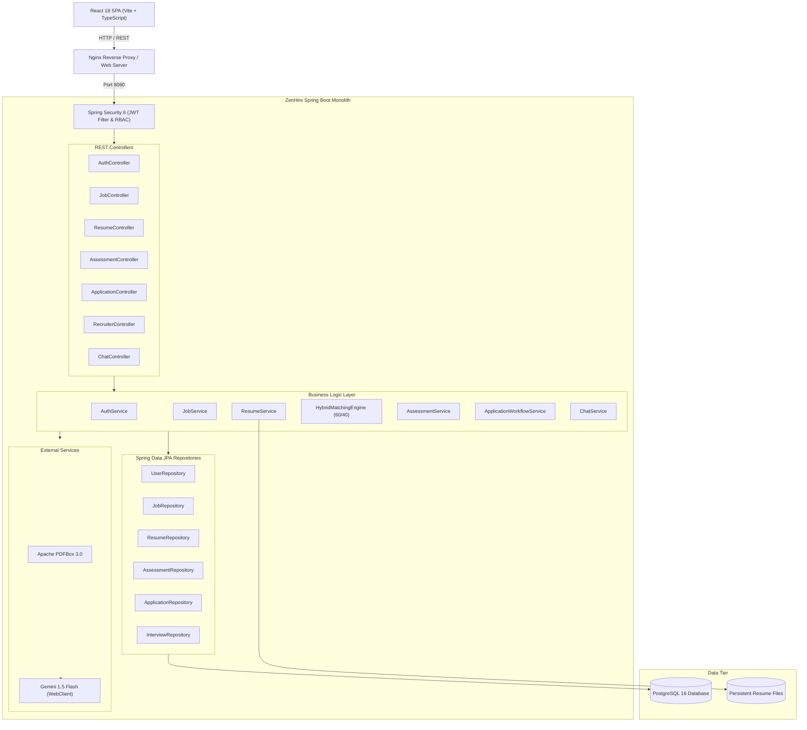

# ZenHire — AI-Powered Recruitment & Talent Intelligence Platform

> **Smarter Hiring. Better Matches.**  
> An enterprise-grade, full-stack recruitment platform engineered with Java 21, Spring Boot 3, React, TypeScript, PostgreSQL, and Google Gemini AI integration.

[]()
[]()
[]()
[]()
[-61DAFB.svg)]()
[]()
[]()

---

## 1. Overview

**ZenHire** is a talent intelligence platform engineered to eliminate keyword-stuffing inefficiencies and bias in modern recruitment. By uniting automated PDF resume parsing, domain-specific assessment gating, a hybrid deterministic-and-semantic candidate-job matching engine, and a context-aware AI assistant, ZenHire provides transparency, fairness, and verifiability across the hiring lifecycle.

ZenHire is built as a clean modular monolith adhering to layered architecture, strict Flyway database migrations, stateless JWT authentication with Spring Security 6, comprehensive RESTful APIs, and full multi-container Docker deployment.

---

## 2. Key Features

### 🏢 Recruiter Command Center
- **Job Requisition Authoring:** Create and publish engineering requisitions with required tech stacks, interactive skill chips, and role track tags (`BACKEND`, `FRONTEND`, `AI_ML`).
- **Ranked Candidate Pipeline:** Automated candidate leaderboard ranked in real-time by 60/40 hybrid compatibility scores.
- **Candidate Dossier Review:** Inspect parsed resumes, deterministic skill overlaps, missing skill tags, assessment scores, and AI narrative reasoning.
- **Pipeline Workflow Management:** Strict status lifecycle (`APPLIED` ➔ `SHORTLISTED` ➔ `INTERVIEW_SCHEDULED` ➔ `HIRED` / `REJECTED`).
- **Integrated Interview Scheduling:** Schedule online (Google Meet) or on-site interviews with date/time pickers and meeting notes.
- **Recruitment Analytics:** KPI metrics for open requisitions, total applicants, and shortlisted talent.

### 👨‍💻 Candidate Experience
- **AI Resume Intelligence:** Drag-and-drop PDF resume upload extracted via Apache PDFBox 3.0 and Gemini 1.5 Flash into structured tech stacks, verified experience summaries, and education.
- **Technical Assessment Gating:** Role-specific multiple-choice assessments with topic tags, difficulty levels, and server-side grading. Passing the domain assessment unlocks job application gates.
- **60/40 Hybrid AI Matching:** Dual progress breakdown showing 60% deterministic skill overlap and 40% LLM qualitative narrative fit.
- **Application Tracking Pipeline:** Live tracking cards with interview schedules, recruiter notes, and real-time status badges.
- **AI Career Assistant:** Floating conversational assistant grounded in the candidate's actual resume, assessment results, and application status.

### 🎨 Modern Design System
- **Dual-Theme Engine:** Seamless Light and Dark modes with semantic HSL CSS tokens and persistent user preferences.
- **Smooth Theme Transitions:** 250ms transition delay across all colors, surfaces, borders, and typography for a refined visual experience.
- **Zero FOUT:** Pre-render script eliminates light/dark screen flashes on page load.
- **Responsive Layouts:** Mobile-first architecture supporting viewports from 320px to 1920px with dedicated drawer navigation.

---

## 3. Technology Stack

| Layer | Technology | Details |
| :--- | :--- | :--- |
| **Backend** | Java 21, Spring Boot 3.3.0 | Spring Web, Spring Data JPA, Hibernate, Bean Validation |
| **Security** | Spring Security 6, JWT, BCrypt | Stateless authorization, granular role-based access (`CANDIDATE`, `RECRUITER`) |
| **Database** | PostgreSQL 16, Flyway 10 | Versioned SQL migrations (`V1`, `V2`, `V3`), relational constraints, indexing |
| **Document Processing** | Apache PDFBox 3.0 | Deterministic text stream extraction from uploaded PDF resumes |
| **AI Integration** | Google Gemini 1.5 Flash | Structured resume extraction, candidate-job narrative scoring, career advisory |
| **Frontend** | React 18, TypeScript, Vite 5 | SPA with React Router v6, Axios interceptors, Lucide React icons |
| **Styling** | Tailwind CSS 3 | Custom semantic tokens, subtle glassmorphism, responsive utilities |
| **DevOps & Containers** | Docker, Docker Compose, Nginx | Multi-stage builds for backend JAR and frontend Nginx static distribution |
| **Testing** | JUnit 5, Mockito, Vitest | Unit, slice, security, and component tests |

---

## 4. Architecture Overview

ZenHire follows a clean **Layered Architecture** with feature-based package organization:



---

## 5. Quick Start Guide

### Prerequisites
- **Docker & Docker Compose** (v24+) — *Recommended*
- Or locally: **Java 21**, **Node.js 20+**, **Maven 3.9+**, **PostgreSQL 16**
- **Google Gemini API Key** (available free at [Google AI Studio](https://aistudio.google.com/))

---

### Option A: Running via Docker Compose (Recommended)

1. **Clone the repository:**
   ```bash
   git clone https://github.com/Sumanthrillex07/ZenHire.git
   cd ZenHire
   ```

2. **Configure environment variables:**
   ```bash
   cp .env.example .env
   # Add your GEMINI_API_KEY in .env
   ```

3. **Start all services:**
   ```bash
   docker compose up --build -d
   ```

4. **Verify application status:**
   - **Frontend UI:** [http://localhost:3000](http://localhost:3000)
   - **Backend API:** [http://localhost:8080/api](http://localhost:8080/api)
   - **Health Check:** [http://localhost:8080/api/health](http://localhost:8080/api/health)

---

### Option B: Local Development Setup

#### 1. Start PostgreSQL
```bash
docker run --name zenhire-postgres -e POSTGRES_DB=zenhire_db -e POSTGRES_USER=zenhire_user -e POSTGRES_PASSWORD=zenhire_secure_pass_2026 -p 5432:5432 -d postgres:16-alpine
```

#### 2. Start Backend
```bash
cd backend
mvn clean spring-boot:run -Dspring-boot.run.profiles=dev
```
*Flyway automatically runs all database migrations on startup.*

#### 3. Start Frontend
```bash
cd frontend
npm install
npm run dev
```
*Frontend dev server will be available at [http://localhost:5173](http://localhost:5173).*

---

### Seed Demo Credentials

The database is pre-seeded with sample users for testing:

| Role | Email | Password | Access |
| :--- | :--- | :--- | :--- |
| **Candidate** | `candidate@zenhire.com` | `password123` | Dashboard, Job Browse, Assessments, Resume Sync, Applications |
| **Recruiter** | `recruiter@zenhire.com` | `password123` | Command Center, Job Requisition Post, Ranked Applicant Pipelines |

---

## 6. Repository Layout

```
ZenHire/
├── docker-compose.yml            # Multi-container orchestration (App, DB, UI)
├── .env.example                  # Environment configuration template
├── README.md                     # Master project README
├── backend/                      # Spring Boot 3.3.x Backend (Java 21)
│   ├── pom.xml                   # Maven dependencies & plugins
│   ├── Dockerfile                # Multi-stage JDK/JRE build
│   ├── README.md                 # Backend technical guide
│   └── src/
│       ├── main/java/com/zenhire/
│       │   ├── auth/             # Login, register, JWT token service
│       │   ├── candidate/        # Candidate profiles & diagnostics
│       │   ├── recruiter/        # Recruiter command center & metrics
│       │   ├── job/              # Job requisitions & search
│       │   ├── resume/           # Apache PDFBox parser & resume models
│       │   ├── assessment/       # Tests, questions, attempt grading
│       │   ├── application/      # Applications & interview scheduling
│       │   ├── matching/         # 60/40 Hybrid matching engine
│       │   ├── chat/             # AI Career Advisor & Gemini integration
│       │   ├── security/         # SecurityConfig, JwtAuthenticationFilter
│       │   └── common/           # Global exception handler, ApiResponse
│       └── main/resources/
│           ├── application.yml   # Spring configuration & profiles
│           └── db/migration/     # Flyway SQL migrations (V1, V2, V3)
├── frontend/                     # React 18 + Vite + TypeScript Frontend
│   ├── package.json
│   ├── vite.config.ts
│   ├── tailwind.config.js        # Design tokens & semantic colors
│   ├── Dockerfile                # Multi-stage build with Nginx distribution
│   ├── README.md                 # Frontend technical guide
│   └── src/
│       ├── api/                  # Axios HTTP client & API endpoints
│       ├── components/           # UI primitives (Button, Input, Card, Modal, Badge)
│       ├── context/              # AuthContext & ThemeContext
│       ├── pages/
│       │   ├── auth/             # Login, Register
│       │   ├── candidate/        # CandidateDashboard, JobBrowse, JobDetail, Resume, Assessments
│       │   ├── recruiter/        # RecruiterDashboard, PostJob, ApplicantList
│       │   └── LandingPage.tsx   # Product landing page
│       └── types/                # TypeScript interfaces & API contracts
├── docs/                         # Architecture, Design & Audit Documentation
└── learning/                     # Technical Architecture & Engineering Guides
```

---

## 7. Documentation Directory

Detailed engineering specifications and architecture documents:

| Document | Purpose |
| :--- | :--- |
| [**Project Overview**](docs/PROJECT_OVERVIEW.md) | Problem statement, value proposition, personas, and system scope. |
| [**Software Requirements**](docs/SOFTWARE_REQUIREMENTS_SPECIFICATION.md) | Functional & non-functional requirements and acceptance criteria. |
| [**High-Level Design**](docs/HIGH_LEVEL_DESIGN.md) | System topology, request flow, and deployment architecture. |
| [**Low-Level Design**](docs/LOW_LEVEL_DESIGN.md) | Package structure, class responsibilities, and sequence diagrams. |
| [**Database Design**](docs/DATABASE_DESIGN.md) | Schema design, foreign key constraints, ER diagrams, indexing. |
| [**REST API Specification**](docs/API_SPECIFICATION.md) | Endpoints, HTTP methods, request/response DTO schemas. |
| [**Security Design**](docs/SECURITY_DESIGN.md) | Spring Security 6 architecture, JWT lifecycle, RBAC rules. |
| [**AI Architecture**](docs/AI_ARCHITECTURE.md) | Gemini integration, 60/40 matching engine, prompt engineering. |
| [**Docker & Deployment**](docs/DOCKER_AND_DEPLOYMENT.md) | Multi-stage Dockerfiles, networking, health checks. |
| [**Testing Strategy**](docs/TESTING_STRATEGY.md) | Unit, slice, security, and component testing strategy. |
| [**Design System**](docs/DESIGN_SYSTEM.md) | Semantic color tokens, typography scale, components, transitions. |
| [**UI/UX Audit**](docs/UI_UX_AUDIT.md) | Comprehensive frontend audit and root-cause analysis. |
| [**UI/UX Implementation Report**](docs/UI_UX_IMPLEMENTATION_REPORT.md) | Verification report of redesigned pages, responsive breakpoints, theme mechanics. |
| [**Architecture Decision Records**](docs/ARCHITECTURE_DECISION_RECORDS.md) | Technical decisions (ADR-001 to ADR-010) and trade-offs. |
| [**Proposed Enhancements**](docs/PROPOSED_ENHANCEMENTS.md) | Post-v1 product roadmap and scalability milestones. |

---

## 8. Engineering Guides & Learning Notes

In-depth technical guides covering the core concepts implemented in ZenHire:

1. [**01. Project Architecture**](learning/01-project-architecture.md) — Modular monolith, boundaries, architectural styles.
2. [**02. Spring Boot Fundamentals**](learning/02-spring-boot-fundamentals.md) — Auto-configuration, Bean lifecycle, Dependency Injection.
3. [**03. Layered Architecture**](learning/03-layered-architecture.md) — Separation of concerns, DTOs, Mappers, Transaction boundaries.
4. [**04. REST API Design**](learning/04-rest-api-design.md) — Idempotency, HTTP verbs, status codes, validation, global error handling.
5. [**05. Spring Data JPA**](learning/05-spring-data-jpa.md) — Entity graphs, fetch types, N+1 query optimization, dirty checking.
6. [**06. PostgreSQL & Database Design**](learning/06-postgresql-and-database-design.md) — Normalization, indexing strategies, constraints, foreign keys.
7. [**07. Spring Security & JWT**](learning/07-spring-security-and-jwt.md) — SecurityFilterChain, JWT claims, HMAC verification, stateless RBAC.
8. [**08. React Architecture**](learning/08-react-architecture.md) — Component modularity, custom hooks, context, route guards, Axios interceptors.
9. [**09. Docker & Docker Compose**](learning/09-docker-and-docker-compose.md) — Container virtualization, bridge networks, health checks, multi-stage builds.
10. [**10. Flyway Migrations**](learning/10-flyway-migrations.md) — Schema versioning, checksum validation, baseline strategies.
11. [**11. AI Integration**](learning/11-ai-integration.md) — Prompt engineering, schema enforcement, untrusted input handling, fallback resilience.
12. [**12. Testing & Debugging**](learning/12-testing-and-debugging.md) — MockMvc, Mockito, slice testing, Testcontainers, test pyramid principles.

---

## 9. License

This project is licensed under the MIT License - see the [LICENSE](LICENSE) file for details.
