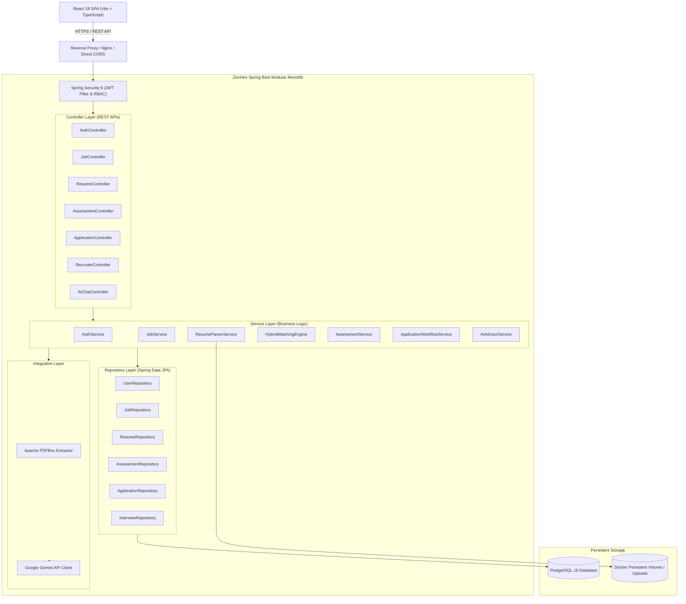

# ZenHire — AI-Powered Recruitment & Talent Intelligence Platform

> **Tagline:** Smarter Hiring. Better Matches.  
> An enterprise-grade, full-stack talent intelligence platform engineered with Java 21, Spring Boot 3, React, TypeScript, PostgreSQL, and Google Gemini LLM integration.

[]()
[]()
[]()
[]()
[-61DAFB.svg)]()
[]()

---

## 1. Executive Summary

**ZenHire** is a next-generation recruitment and talent intelligence platform designed to eliminate keyword-stuffing inefficiencies and bias in traditional hiring funnels. By unifying automated PDF resume parsing, rigorous skill assessment gating, hybrid deterministic-and-semantic candidate-job matching, and a context-aware AI Career Advisor, ZenHire provides end-to-end fairness, verifiability, and transparency for candidates and recruiters alike.

ZenHire is built as an enterprise-grade modular monolith adhering to clean layered architecture, robust database design principles with Flyway migrations, stateless JWT authentication with Spring Security 6, comprehensive RESTful APIs, and full containerization via Docker Compose.

---

## 2. Core Functional Capabilities

### 🏢 Recruiter Capabilities
- **Job Posting & Requisition Lifecycle:** Create, edit, publish, and close job postings with granular technical skill requirements and role category tags (`FRONTEND`, `BACKEND`, `AI_ML`).
- **Ranked Applicant Pipelines:** Automatic candidate ranking utilizing ZenHire's hybrid matching score (combining deterministic skill overlap with LLM narrative evaluation).
- **Candidate Dossier Inspection:** Deep-dive into verified applicant profiles, parsed resumes, skill overlap breakdowns, missing skills, and assessment scores.
- **Workflow State Management:** Strict lifecycle state machine: `APPLIED` ➔ `SHORTLISTED` ➔ `INTERVIEW_SCHEDULED` ➔ `HIRED` (or `REJECTED` from any non-terminal state).
- **Interview Scheduling:** Integrated interview scheduling coordinator supporting online and in-person interviews with calendar metadata and notes.
- **Talent Analytics:** High-level dashboard KPI metrics including active job postings, application volumes, shortlist velocity, and top-tier talent matches.

### 👨‍💻 Candidate Capabilities
- **Profile & Resume Intelligence:** Drag-and-drop PDF resume upload parsed via Apache PDFBox and Google Gemini 1.5 into structured technical skills, experience summaries, and education history.
- **Assessment Gating System:** Role-specific multiple-choice assessments (with randomized question ordering and server-side answer evaluation) that gate job applications to guarantee technical competency.
- **Personalized Job Discovery:** Filter jobs by category with real-time match scores and application unlock statuses.
- **End-to-End Application Tracking:** Interactive visual pipeline displaying active application statuses, recruiter notes, and scheduled interview details.
- **Skills Analytics Feedback:** Personalized feedback dashboard identifying verified topic strengths and improvement areas derived from test attempts.
- **AI Career Advisor:** Context-grounded conversational assistant that references the candidate's actual resume, test results, and application statuses to deliver actionable career guidance.

---

## 3. Technology Stack

| Domain | Technology | Justification |
| :--- | :--- | :--- |
| **Backend Framework** | Java 21, Spring Boot 3.3.x | Modern virtual threads support, strong typing, mature ecosystem, enterprise reliability. |
| **Security & Auth** | Spring Security 6, JWT, BCrypt | Stateless authorization, granular role-based access control (`ROLE_CANDIDATE`, `ROLE_RECRUITER`), secure password hashing. |
| **Persistence & ORM** | Spring Data JPA, Hibernate, PostgreSQL 16 | Relational consistency, foreign key constraints, transactional integrity, JSONB support for semi-structured data where appropriate. |
| **Database Migrations**| Flyway | Idempotent, repeatable, version-controlled schema evolution with zero manual database tampering. |
| **Document Processing**| Apache PDFBox 3.x | Industrial-strength, deterministic PDF text stream extraction. |
| **AI Integration** | Google Gemini 1.5 Flash (REST / Spring WebClient) | Fast, cost-efficient, low-latency structured extraction, resume narrative scoring, and contextual advisory. |
| **Frontend Framework** | React 18, Vite, TypeScript | Modern developer experience, strict type-safety, rapid compilation and component lifecycle management. |
| **Styling & UI System**| Tailwind CSS, shadcn/ui, Lucide Icons | Accessible, responsive, customizable design system with professional dark/light enterprise aesthetics. |
| **Client State & API** | React Router v6, Axios, React Hook Form, Zod | Client-side routing, protected navigation guards, schema validation, interceptor-based JWT management. |
| **Infrastructure** | Docker, Docker Compose, Multi-stage builds | Fully reproducible environment parity across development, staging, and production environments. |
| **Testing** | JUnit 5, Mockito, MockMvc, AssertJ, Vitest | Comprehensive testing pyramid: unit tests, slice integration tests, security tests, and component tests. |

---

## 4. Architecture Overview

ZenHire follows a clean **Layered Architecture** with strict package-by-feature boundaries within a modular monolith design:



---

## 5. Repository & Workspace Structure

```
ZenHire/
├── .github/                      # CI/CD Workflows
├── docker-compose.yml            # Multi-container orchestration (App, DB, UI)
├── .env.example                  # Environment configuration template
├── README.md                     # Master project README
├── backend/                      # Spring Boot 3.x Backend
│   ├── pom.xml                   # Maven dependencies & plugins
│   ├── Dockerfile                # Multi-stage Java 21 build
│   └── src/
│       ├── main/
│       │   ├── java/com/zenhire/
│       │   │   ├── ZenHireApplication.java
│       │   │   ├── common/       # Global DTOs, ApiResponse, Exceptions
│       │   │   ├── config/       # SecurityConfig, CorsConfig, WebMvcConfig
│       │   │   ├── security/     # JwtTokenProvider, UserDetails, Filters
│       │   │   ├── auth/         # Authentication & Registration
│       │   │   ├── candidate/    # Candidate profiles & analytics
│       │   │   ├── recruiter/    # Recruiter profiles & metrics
│       │   │   ├── job/          # Job postings & discovery
│       │   │   ├── resume/       # PDF parsing & resume history
│       │   │   ├── assessment/   # Tests, questions, attempt evaluation
│       │   │   ├── application/  # Applications & interview scheduling
│       │   │   ├── matching/     # Hybrid scoring & ranking algorithm
│       │   │   └── ai/           # Gemini LLM client, prompts, structured parsing
│       │   └── resources/
│       │       ├── application.yml
│       │       ├── application-dev.yml
│       │       ├── application-prod.yml
│       │       └── db/migration/ # Flyway SQL migrations (V1, V2...)
│       └── test/                 # JUnit 5 & Mockito test suite
├── frontend/                     # React 18 + Vite + TypeScript Frontend
│   ├── package.json
│   ├── vite.config.ts
│   ├── tailwind.config.js
│   ├── Dockerfile                # Multi-stage Nginx build
│   └── src/
│       ├── api/                  # Axios HTTP client & API service modules
│       ├── components/           # shadcn/ui & reusable presentation components
│       ├── context/              # AuthContext & Session management
│       ├── hooks/                # Custom React hooks
│       ├── layouts/              # AppLayout, Navbar, Footer
│       ├── pages/                # Route page components
│       │   ├── auth/             # Login, Register
│       │   ├── candidate/        # Dashboard, Resume, JobBrowse, TestRunner, Chat
│       │   └── recruiter/        # Dashboard, JobForm, ApplicantList
│       └── types/                # TypeScript interfaces & API contracts
├── docs/                         # Engineering Architecture & Requirements Specs
│   ├── PROJECT_OVERVIEW.md
│   ├── SOFTWARE_REQUIREMENTS_SPECIFICATION.md
│   ├── HIGH_LEVEL_DESIGN.md
│   ├── LOW_LEVEL_DESIGN.md
│   ├── DATABASE_DESIGN.md
│   ├── API_SPECIFICATION.md
│   ├── SECURITY_DESIGN.md
│   ├── AI_ARCHITECTURE.md
│   ├── DOCKER_AND_DEPLOYMENT.md
│   ├── TESTING_STRATEGY.md
│   ├── IMPLEMENTATION_PLAN.md
│   ├── IMPLEMENTATION_STATUS.md
│   ├── ARCHITECTURE_DECISION_RECORDS.md
│   └── PROPOSED_ENHANCEMENTS.md
└── learning/                     # SDE-1 Engineering Masterclass Learning Notes
    ├── 01-project-architecture.md
    ├── 02-spring-boot-fundamentals.md
    ├── 03-layered-architecture.md
    ├── 04-rest-api-design.md
    ├── 05-spring-data-jpa.md
    ├── 06-postgresql-and-database-design.md
    ├── 07-spring-security-and-jwt.md
    ├── 08-react-architecture.md
    ├── 09-docker-and-docker-compose.md
    ├── 10-flyway-migrations.md
    ├── 11-ai-integration.md
    └── 12-testing-and-debugging.md
```

---

## 6. Quick Start Guide

### Prerequisites
- **Java 21** JDK installed
- **Node.js 20+** and npm
- **Maven 3.9+**
- **Docker & Docker Compose** (v24+)
- **Google Gemini API Key** (free tier available at [Google AI Studio](https://aistudio.google.com/))

---

### Option A: Running via Docker Compose (Recommended)

1. **Clone the repository:**
   ```bash
   git clone https://github.com/Sumanthrillex07/ZenHire.git
   cd ZenHire
   ```

2. **Configure environment variables:**
   ```bash
   cp .env.example .env
   # Open .env and add your GEMINI_API_KEY
   ```

3. **Build and launch all services:**
   ```bash
   docker compose up --build
   ```

4. **Access the application:**
   - **Frontend UI:** [http://localhost:5173](http://localhost:5173) (or `http://localhost:3000`)
   - **Backend API:** [http://localhost:8080/api/v1](http://localhost:8080/api/v1)
   - **Health Endpoint:** [http://localhost:8080/api/v1/actuator/health](http://localhost:8080/api/v1/actuator/health)
   - **Swagger / OpenAPI:** [http://localhost:8080/swagger-ui.html](http://localhost:8080/swagger-ui.html)

---

### Option B: Local Development Setup

#### 1. Start PostgreSQL Database
```bash
docker run --name zenhire-postgres -e POSTGRES_DB=zenhire_db -e POSTGRES_USER=zenhire_user -e POSTGRES_PASSWORD=zenhire_secure_pass_2026 -p 5432:5432 -d postgres:16-alpine
```

#### 2. Start Spring Boot Backend
```bash
cd backend
mvn clean spring-boot:run -Dspring-boot.run.profiles=dev
```
*Flyway will automatically execute all SQL migrations on application startup.*

#### 3. Start React Frontend
```bash
cd frontend
npm install
npm run dev
```

---

## 7. Documentation Directory Index

Comprehensive engineering documents are available in the [`docs/`](file:///d:/ZenHire/docs) folder:

| Document | Purpose |
| :--- | :--- |
| [**Project Overview**](file:///d:/ZenHire/docs/PROJECT_OVERVIEW.md) | Problem statement, value proposition, user personas, and scope. |
| [**Software Requirements Specification**](file:///d:/ZenHire/docs/SOFTWARE_REQUIREMENTS_SPECIFICATION.md) | Detailed functional & non-functional requirements, use cases, acceptance criteria. |
| [**High-Level Design**](file:///d:/ZenHire/docs/HIGH_LEVEL_DESIGN.md) | System topology, component interactions, request lifecycle, deployment architecture. |
| [**Low-Level Design**](file:///d:/ZenHire/docs/LOW_LEVEL_DESIGN.md) | Package structure, class responsibilities, sequence diagrams, design patterns. |
| [**Database Design**](file:///d:/ZenHire/docs/DATABASE_DESIGN.md) | PostgreSQL schema, ER diagrams, foreign keys, indexing strategy, normalization. |
| [**REST API Specification**](file:///d:/ZenHire/docs/API_SPECIFICATION.md) | Endpoints, HTTP verbs, request/response DTO contracts, status codes, error shapes. |
| [**Security Design**](file:///d:/ZenHire/docs/SECURITY_DESIGN.md) | Spring Security 6 architecture, JWT lifecycle, RBAC, input sanitization, file security. |
| [**AI Architecture**](file:///d:/ZenHire/docs/AI_ARCHITECTURE.md) | Gemini integration, hybrid scoring engine, prompt engineering, resilience fallbacks. |
| [**Docker & Deployment**](file:///d:/ZenHire/docs/DOCKER_AND_DEPLOYMENT.md) | Multi-stage Dockerfiles, Compose networking, health checks, environment secrets. |
| [**Testing Strategy**](file:///d:/ZenHire/docs/TESTING_STRATEGY.md) | Unit, integration, security, and frontend testing specifications and test cases. |
| [**Implementation Plan**](file:///d:/ZenHire/docs/IMPLEMENTATION_PLAN.md) | Phase-by-phase execution roadmap with dependencies, tasks, and deliverables. |
| [**Implementation Status**](file:///d:/ZenHire/docs/IMPLEMENTATION_STATUS.md) | Real-time progress tracking checklist for all development phases. |
| [**Architecture Decision Records**](file:///d:/ZenHire/docs/ARCHITECTURE_DECISION_RECORDS.md) | Key technical decisions (ADR-001 to ADR-010) and trade-off analyses. |
| [**Proposed Enhancements**](file:///d:/ZenHire/docs/PROPOSED_ENHANCEMENTS.md) | Strategic post-v1 product roadmap features and scalability improvements. |

---

## 8. SDE-1 Engineering Masterclass Learning Notes

A dedicated [`learning/`](file:///d:/ZenHire/learning) directory provides structured deep-dives addressing 8 core production engineering questions plus interview prep for every major architectural layer:

1. [**01. Project Architecture**](file:///d:/ZenHire/learning/01-project-architecture.md) — Modular monolith, boundaries, architectural styles.
2. [**02. Spring Boot Fundamentals**](file:///d:/ZenHire/learning/02-spring-boot-fundamentals.md) — Auto-configuration, Bean lifecycle, Dependency Injection.
3. [**03. Layered Architecture**](file:///d:/ZenHire/learning/03-layered-architecture.md) — Separation of concerns, DTOs, Mappers, Transaction borders.
4. [**04. REST API Design**](file:///d:/ZenHire/learning/04-rest-api-design.md) — Idempotency, HTTP verbs, status codes, validation, global error handling.
5. [**05. Spring Data JPA**](file:///d:/ZenHire/learning/05-spring-data-jpa.md) — Entity graphs, fetch types, N+1 query problem, dirty checking, repository contracts.
6. [**06. PostgreSQL & Database Design**](file:///d:/ZenHire/learning/06-postgresql-and-database-design.md) — Normalization, indexing strategies, constraints, foreign keys.
7. [**07. Spring Security & JWT**](file:///d:/ZenHire/learning/07-spring-security-and-jwt.md) — SecurityFilterChain, JWT claims, HMAC verification, stateless RBAC.
8. [**08. React Architecture**](file:///d:/ZenHire/learning/08-react-architecture.md) — Component modularity, custom hooks, context, route guards, Axios interceptors.
9. [**09. Docker & Docker Compose**](file:///d:/ZenHire/learning/09-docker-and-docker-compose.md) — Container virtualization, bridge networks, health checks, multi-stage builds.
10. [**10. Flyway Migrations**](file:///d:/ZenHire/learning/10-flyway-migrations.md) — Schema versioning, checksum validation, baseline strategies, rollback safety.
11. [**11. AI Integration**](file:///d:/ZenHire/learning/11-ai-integration.md) — Prompt engineering, schema enforcement, untrusted input handling, fallback resilience.
12. [**12. Testing & Debugging**](file:///d:/ZenHire/learning/12-testing-and-debugging.md) — MockMvc, Mockito, slice testing, Testcontainers, test pyramid principles.

---

## 9. License

This project is licensed under the MIT License - see the [LICENSE](LICENSE) file for details.
