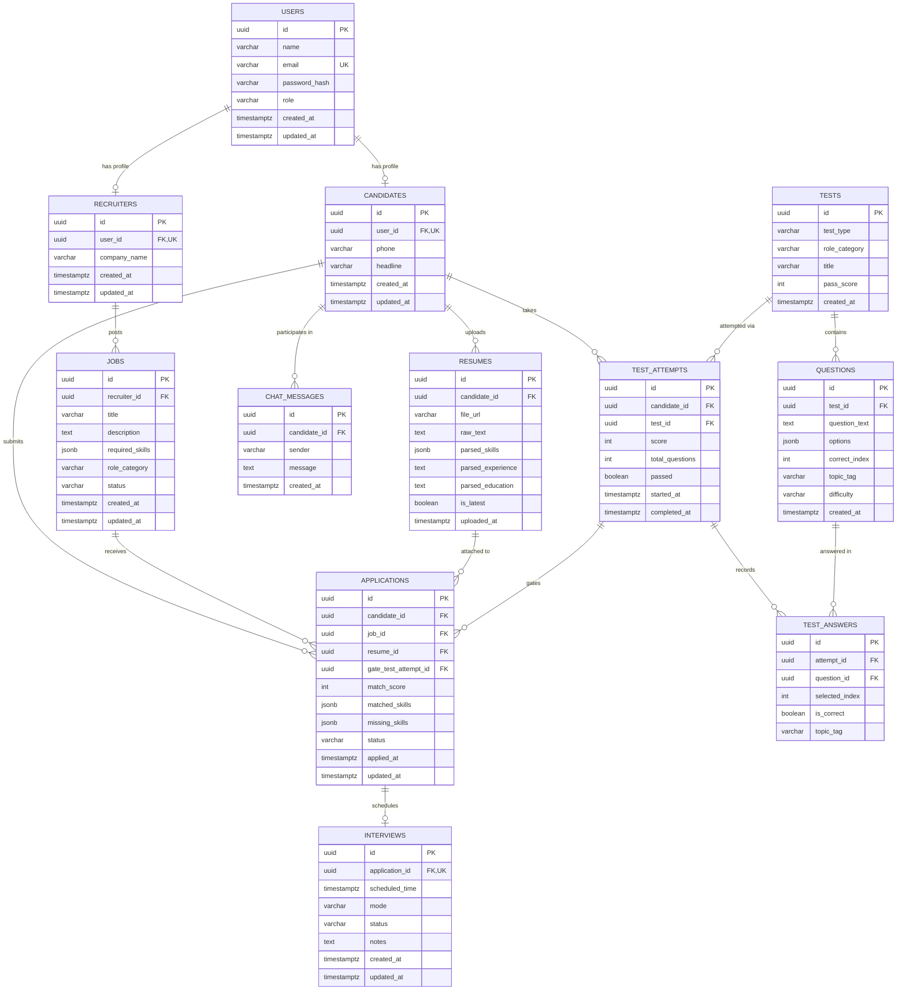

# ZenHire — Database Design & Schema Specification

> **Document Type:** Database Design & Data Architecture  
> **Target Database Engine:** PostgreSQL 16  
> **Schema Migration Tool:** Flyway (SQL Versioned Migrations)  
> **Version:** 1.0.0 (Production Blueprint)

---

## 1. Database Architectural Principles

ZenHire’s PostgreSQL database design adheres to strict relational database design best practices:

1. **Surrogate Primary Keys:** All tables use `UUID` primary keys (`gen_random_uuid()` in PostgreSQL) to eliminate predictable sequential ID vulnerabilities, prevent enumeration attacks, and facilitate future distributed data scaling.
2. **Strict Foreign Key Constraints & Referential Integrity:** Cascade rules are explicitly defined (`ON DELETE CASCADE` for parent-child ownership, such as questions in a test; `ON DELETE RESTRICT` for audited records, such as applications).
3. **Normalized Relational Modeling:** Unlike naive implementations that store arbitrary JSON strings in SQLite, ZenHire uses normalized relational columns, native PostgreSQL `JSONB` for structured arrays (e.g., question choices), and proper enumeration constraints.
4. **Timezone Awareness:** All timestamps use `TIMESTAMP WITH TIME ZONE` (`TIMESTAMPTZ`) to guarantee unambiguous international audit trails.
5. **Targeted Indexing:** B-Tree indexes are defined for every foreign key, lookup column (e.g., email), filter column (`status`, `role_category`), and composite unique constraints (`candidate_id + job_id`).

---

## 2. Entity-Relationship (ER) Diagram



---

## 3. Table Definitions & DDL Specifications

### 3.1 Table: `users`
Stores unified identity credentials for all platform actors.

| Column | Data Type | Constraints | Description |
| :--- | :--- | :--- | :--- |
| `id` | `UUID` | `PRIMARY KEY DEFAULT gen_random_uuid()` | Unique user identifier. |
| `name` | `VARCHAR(100)` | `NOT NULL` | Full legal or display name. |
| `email` | `VARCHAR(255)` | `NOT NULL UNIQUE` | Normalized lowercase email address. |
| `password_hash` | `VARCHAR(255)` | `NOT NULL` | BCrypt password hash. |
| `role` | `VARCHAR(30)` | `NOT NULL CHECK (role IN ('ROLE_CANDIDATE', 'ROLE_RECRUITER'))` | User role for Spring Security RBAC. |
| `created_at` | `TIMESTAMPTZ` | `NOT NULL DEFAULT CURRENT_TIMESTAMP` | Audit creation timestamp. |
| `updated_at` | `TIMESTAMPTZ` | `NOT NULL DEFAULT CURRENT_TIMESTAMP` | Audit update timestamp. |

---

### 3.2 Table: `candidates`
Stores profile metadata specific to candidate accounts.

| Column | Data Type | Constraints | Description |
| :--- | :--- | :--- | :--- |
| `id` | `UUID` | `PRIMARY KEY DEFAULT gen_random_uuid()` | Unique candidate identifier. |
| `user_id` | `UUID` | `NOT NULL UNIQUE REFERENCES users(id) ON DELETE CASCADE` | 1-to-1 link to user identity. |
| `phone` | `VARCHAR(30)` | `NULL` | Optional contact telephone number. |
| `headline` | `VARCHAR(255)` | `NULL` | Professional headline / summary tagline. |
| `created_at` | `TIMESTAMPTZ` | `NOT NULL DEFAULT CURRENT_TIMESTAMP` | Profile creation timestamp. |
| `updated_at` | `TIMESTAMPTZ` | `NOT NULL DEFAULT CURRENT_TIMESTAMP` | Profile update timestamp. |

---

### 3.3 Table: `recruiters`
Stores enterprise recruiter and company affiliation details.

| Column | Data Type | Constraints | Description |
| :--- | :--- | :--- | :--- |
| `id` | `UUID` | `PRIMARY KEY DEFAULT gen_random_uuid()` | Unique recruiter identifier. |
| `user_id` | `UUID` | `NOT NULL UNIQUE REFERENCES users(id) ON DELETE CASCADE` | 1-to-1 link to user identity. |
| `company_name` | `VARCHAR(150)` | `NOT NULL` | Registered company / organization name. |
| `created_at` | `TIMESTAMPTZ` | `NOT NULL DEFAULT CURRENT_TIMESTAMP` | Profile creation timestamp. |
| `updated_at` | `TIMESTAMPTZ` | `NOT NULL DEFAULT CURRENT_TIMESTAMP` | Profile update timestamp. |

---

### 3.4 Table: `resumes`
Stores uploaded PDF documents and structured extraction records.

| Column | Data Type | Constraints | Description |
| :--- | :--- | :--- | :--- |
| `id` | `UUID` | `PRIMARY KEY DEFAULT gen_random_uuid()` | Unique resume identifier. |
| `candidate_id` | `UUID` | `NOT NULL REFERENCES candidates(id) ON DELETE CASCADE` | Candidate who uploaded the resume. |
| `file_url` | `VARCHAR(500)` | `NOT NULL` | Relative or static URL path to the stored PDF. |
| `raw_text` | `TEXT` | `NOT NULL` | Raw text stream extracted via Apache PDFBox. |
| `parsed_skills` | `JSONB` | `NOT NULL DEFAULT '[]'` | JSONB array of technical skill strings. |
| `parsed_experience` | `TEXT` | `NULL` | LLM-generated work experience narrative summary. |
| `parsed_education` | `TEXT` | `NULL` | LLM-generated education history summary. |
| `is_latest` | `BOOLEAN` | `NOT NULL DEFAULT TRUE` | Flags active resume for candidate matching. |
| `uploaded_at` | `TIMESTAMPTZ` | `NOT NULL DEFAULT CURRENT_TIMESTAMP` | Upload timestamp. |

---

### 3.5 Table: `jobs`
Stores job postings published by recruiters.

| Column | Data Type | Constraints | Description |
| :--- | :--- | :--- | :--- |
| `id` | `UUID` | `PRIMARY KEY DEFAULT gen_random_uuid()` | Unique job identifier. |
| `recruiter_id` | `UUID` | `NOT NULL REFERENCES recruiters(id) ON DELETE CASCADE` | Recruiter who published the role. |
| `title` | `VARCHAR(150)` | `NOT NULL` | Job requisition title. |
| `description` | `TEXT` | `NOT NULL` | Detailed job description and responsibilities. |
| `required_skills` | `JSONB` | `NOT NULL DEFAULT '[]'` | JSONB array of mandatory skill strings. |
| `role_category` | `VARCHAR(50)` | `NOT NULL CHECK (role_category IN ('FRONTEND', 'BACKEND', 'AI_ML'))` | Role category matching assessment tracks. |
| `status` | `VARCHAR(20)` | `NOT NULL DEFAULT 'OPEN' CHECK (status IN ('OPEN', 'CLOSED'))` | Current requisition status. |
| `created_at` | `TIMESTAMPTZ` | `NOT NULL DEFAULT CURRENT_TIMESTAMP` | Requisition creation timestamp. |
| `updated_at` | `TIMESTAMPTZ` | `NOT NULL DEFAULT CURRENT_TIMESTAMP` | Requisition update timestamp. |

---

### 3.6 Table: `tests`
Defines general aptitude and role-specific assessment specifications.

| Column | Data Type | Constraints | Description |
| :--- | :--- | :--- | :--- |
| `id` | `UUID` | `PRIMARY KEY DEFAULT gen_random_uuid()` | Unique test identifier. |
| `test_type` | `VARCHAR(30)` | `NOT NULL CHECK (test_type IN ('GENERAL', 'ROLE_SPECIFIC'))` | Type of assessment. |
| `role_category` | `VARCHAR(50)` | `NULL CHECK (role_category IS NULL OR role_category IN ('FRONTEND', 'BACKEND', 'AI_ML'))` | Category gated by this test (null for GENERAL). |
| `title` | `VARCHAR(150)` | `NOT NULL` | Display title of the assessment. |
| `pass_score` | `INT` | `NOT NULL DEFAULT 60 CHECK (pass_score BETWEEN 1 AND 100)` | Minimum percentage required to pass. |
| `created_at` | `TIMESTAMPTZ` | `NOT NULL DEFAULT CURRENT_TIMESTAMP` | Creation timestamp. |

---

### 3.7 Table: `questions`
Contains multiple-choice assessment questions.

| Column | Data Type | Constraints | Description |
| :--- | :--- | :--- | :--- |
| `id` | `UUID` | `PRIMARY KEY DEFAULT gen_random_uuid()` | Unique question identifier. |
| `test_id` | `UUID` | `NOT NULL REFERENCES tests(id) ON DELETE CASCADE` | Test to which this question belongs. |
| `question_text` | `TEXT` | `NOT NULL` | The question stem. |
| `options` | `JSONB` | `NOT NULL` | JSONB array of 4 option strings (e.g. `["A", "B", "C", "D"]`). |
| `correct_index` | `INT` | `NOT NULL CHECK (correct_index BETWEEN 0 AND 3)` | Zero-based index of correct option. Never sent to client! |
| `topic_tag` | `VARCHAR(100)` | `NOT NULL` | Topic category for skill analytics (e.g. `sql-joins`). |
| `difficulty` | `VARCHAR(20)` | `NOT NULL CHECK (difficulty IN ('EASY', 'MEDIUM', 'HARD'))` | Difficulty tier. |
| `created_at` | `TIMESTAMPTZ` | `NOT NULL DEFAULT CURRENT_TIMESTAMP` | Creation timestamp. |

---

### 3.8 Table: `test_attempts`
Records candidate test sessions and grading results.

| Column | Data Type | Constraints | Description |
| :--- | :--- | :--- | :--- |
| `id` | `UUID` | `PRIMARY KEY DEFAULT gen_random_uuid()` | Unique attempt session identifier. |
| `candidate_id` | `UUID` | `NOT NULL REFERENCES candidates(id) ON DELETE CASCADE` | Candidate taking the test. |
| `test_id` | `UUID` | `NOT NULL REFERENCES tests(id) ON DELETE RESTRICT` | Test attempted. |
| `score` | `INT` | `NOT NULL DEFAULT 0 CHECK (score BETWEEN 0 AND 100)` | Achieved percentage score. |
| `total_questions`| `INT` | `NOT NULL DEFAULT 0` | Total questions in attempt. |
| `passed` | `BOOLEAN` | `NOT NULL DEFAULT FALSE` | True if score >= pass_score. |
| `started_at` | `TIMESTAMPTZ` | `NOT NULL DEFAULT CURRENT_TIMESTAMP` | Session start timestamp. |
| `completed_at` | `TIMESTAMPTZ` | `NULL` | Submission timestamp (null if ongoing). |

---

### 3.9 Table: `test_answers`
Stores itemized candidate responses for fine-grained strength/weakness analysis.

| Column | Data Type | Constraints | Description |
| :--- | :--- | :--- | :--- |
| `id` | `UUID` | `PRIMARY KEY DEFAULT gen_random_uuid()` | Unique answer log identifier. |
| `attempt_id` | `UUID` | `NOT NULL REFERENCES test_attempts(id) ON DELETE CASCADE` | Associated test attempt. |
| `question_id` | `UUID` | `NOT NULL REFERENCES questions(id) ON DELETE CASCADE` | Question answered. |
| `selected_index`| `INT` | `NOT NULL` | Index selected by candidate (-1 if omitted). |
| `is_correct` | `BOOLEAN` | `NOT NULL` | Evaluation outcome. |
| `topic_tag` | `VARCHAR(100)` | `NOT NULL` | Topic tag copied for rapid aggregation. |

---

### 3.10 Table: `applications`
Represents candidate job applications, match evaluations, and gating linkage.

| Column | Data Type | Constraints | Description |
| :--- | :--- | :--- | :--- |
| `id` | `UUID` | `PRIMARY KEY DEFAULT gen_random_uuid()` | Unique application identifier. |
| `candidate_id` | `UUID` | `NOT NULL REFERENCES candidates(id) ON DELETE RESTRICT` | Candidate applying. |
| `job_id` | `UUID` | `NOT NULL REFERENCES jobs(id) ON DELETE RESTRICT` | Job applied to. |
| `resume_id` | `UUID` | `NOT NULL REFERENCES resumes(id) ON DELETE RESTRICT` | Resume snapshot used for matching. |
| `gate_test_attempt_id` | `UUID` | `NOT NULL REFERENCES test_attempts(id) ON DELETE RESTRICT` | Passed test attempt gating this submission. |
| `match_score` | `INT` | `NOT NULL CHECK (match_score BETWEEN 0 AND 100)` | Hybrid match score (0–100). |
| `matched_skills` | `JSONB` | `NOT NULL DEFAULT '[]'` | JSONB array of matching technical skills. |
| `missing_skills` | `JSONB` | `NOT NULL DEFAULT '[]'` | JSONB array of missing required skills. |
| `status` | `VARCHAR(30)` | `NOT NULL DEFAULT 'APPLIED' CHECK (status IN ('APPLIED', 'SHORTLISTED', 'INTERVIEW_SCHEDULED', 'REJECTED', 'HIRED'))` | Current lifecycle state. |
| `applied_at` | `TIMESTAMPTZ` | `NOT NULL DEFAULT CURRENT_TIMESTAMP` | Application submission timestamp. |
| `updated_at` | `TIMESTAMPTZ` | `NOT NULL DEFAULT CURRENT_TIMESTAMP` | Status transition timestamp. |

**Unique Constraint:** `CONSTRAINT uq_candidate_job UNIQUE (candidate_id, job_id)` prevents a candidate from submitting duplicate applications to the same job.

---

### 3.11 Table: `interviews`
Stores scheduled interview sessions linked 1-to-1 to applications.

| Column | Data Type | Constraints | Description |
| :--- | :--- | :--- | :--- |
| `id` | `UUID` | `PRIMARY KEY DEFAULT gen_random_uuid()` | Unique interview identifier. |
| `application_id`| `UUID` | `NOT NULL UNIQUE REFERENCES applications(id) ON DELETE CASCADE` | 1-to-1 link to application. |
| `scheduled_time`| `TIMESTAMPTZ`| `NOT NULL` | Interview date and time. |
| `mode` | `VARCHAR(20)` | `NOT NULL CHECK (mode IN ('ONLINE', 'OFFLINE'))` | Interview format. |
| `status` | `VARCHAR(20)` | `NOT NULL DEFAULT 'SCHEDULED' CHECK (status IN ('SCHEDULED', 'COMPLETED', 'CANCELLED'))` | Interview status. |
| `notes` | `TEXT` | `NULL` | Optional recruiter preparation notes or meeting link. |
| `created_at` | `TIMESTAMPTZ` | `NOT NULL DEFAULT CURRENT_TIMESTAMP` | Creation timestamp. |
| `updated_at` | `TIMESTAMPTZ` | `NOT NULL DEFAULT CURRENT_TIMESTAMP` | Last update timestamp. |

---

### 3.12 Table: `chat_messages`
Stores conversation history between candidate and the AI Career Advisor.

| Column | Data Type | Constraints | Description |
| :--- | :--- | :--- | :--- |
| `id` | `UUID` | `PRIMARY KEY DEFAULT gen_random_uuid()` | Unique message identifier. |
| `candidate_id` | `UUID` | `NOT NULL REFERENCES candidates(id) ON DELETE CASCADE` | Candidate in conversation. |
| `sender` | `VARCHAR(20)` | `NOT NULL CHECK (sender IN ('CANDIDATE', 'AI'))` | Message originator. |
| `message` | `TEXT` | `NOT NULL` | Message textual content. |
| `created_at` | `TIMESTAMPTZ` | `NOT NULL DEFAULT CURRENT_TIMESTAMP` | Creation timestamp. |

---

## 4. Indexing Strategy & Performance Optimization

To guarantee sub-second queries under high volume, the following B-Tree indexes are defined:

```sql
-- 1. Identity & Profile Lookups
CREATE INDEX idx_users_email ON users(email);
CREATE INDEX idx_candidates_user_id ON candidates(user_id);
CREATE INDEX idx_recruiters_user_id ON recruiters(user_id);

-- 2. Resume Queries
CREATE INDEX idx_resumes_candidate_latest ON resumes(candidate_id, is_latest);

-- 3. Job Filtering & Discovery
CREATE INDEX idx_jobs_status_category ON jobs(status, role_category);
CREATE INDEX idx_jobs_recruiter_id ON jobs(recruiter_id);

-- 4. Assessment Lookups & Answer Aggregations
CREATE INDEX idx_questions_test_id ON questions(test_id);
CREATE INDEX idx_test_attempts_candidate_test ON test_attempts(candidate_id, test_id);
CREATE INDEX idx_test_attempts_passed ON test_attempts(candidate_id, passed);
CREATE INDEX idx_test_answers_attempt_id ON test_answers(attempt_id);
CREATE INDEX idx_test_answers_topic_tag ON test_answers(topic_tag);

-- 5. Application Pipeline & Recruiter Sorting
CREATE INDEX idx_applications_job_match_score ON applications(job_id, match_score DESC);
CREATE INDEX idx_applications_job_applied_at ON applications(job_id, applied_at DESC);
CREATE INDEX idx_applications_candidate_id ON applications(candidate_id);

-- 6. Interview & Chat Lookups
CREATE INDEX idx_interviews_application_id ON interviews(application_id);
CREATE INDEX idx_chat_messages_candidate_created ON chat_messages(candidate_id, created_at ASC);
```

---

## 5. Flyway Migration Versioning Strategy

All schema changes will be versioned sequentially in `backend/src/main/resources/db/migration/`:
- `V1__init_schema.sql`: Core table creations, foreign keys, unique constraints, and check constraints.
- `V2__create_indexes.sql`: Performance indexes on foreign keys, status columns, and composite query paths.
- `V3__seed_initial_data.sql`: Base seed questions across general and role-specific assessments, sample recruiter companies, and demonstration accounts.

