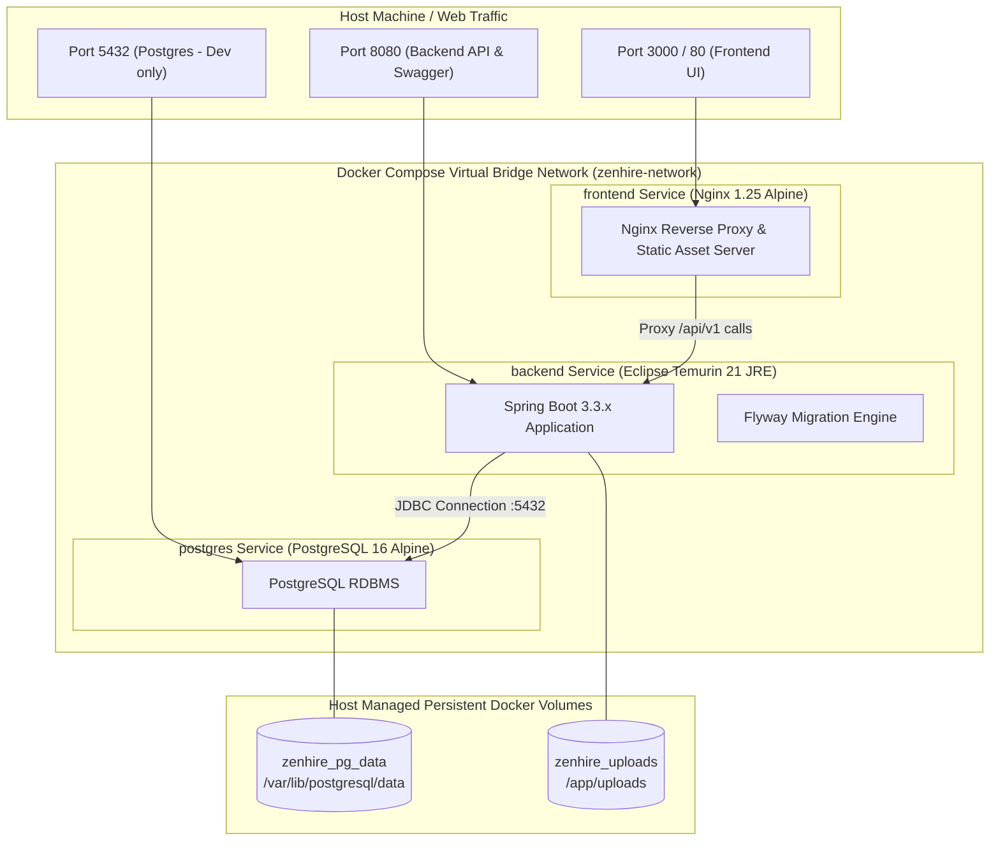

# ZenHire — Docker Architecture & Deployment Guide

> **Document Type:** Containerization, Infrastructure & Deployment Guide  
> **Orchestrator:** Docker Compose v2  
> **Target Base Images:** Eclipse Temurin 21 (JRE Alpine), Node 20 Alpine, Nginx 1.25 Alpine, PostgreSQL 16 Alpine  
> **Version:** 1.0.0 (Production Blueprint)

---

## 1. Container Architecture Overview

ZenHire’s infrastructure is fully containerized across three isolated, communicating micro-services connected via an internal Docker bridge network (`zenhire-network`):



---

## 2. Multi-Stage Dockerfile Specifications

### 2.1 Backend Dockerfile (`backend/Dockerfile`)
The backend utilizes an optimized 2-stage build to isolate the Maven compilation cache from the production runtime image:

```dockerfile
# ==============================================================================
# Stage 1: Build Application with Maven and Java 21
# ==============================================================================
FROM maven:3.9-eclipse-temurin-21-alpine AS builder

WORKDIR /build

# Cache Maven dependencies by copying pom.xml first
COPY pom.xml .
RUN mvn dependency:go-offline -B

# Copy application source code and compile jar
COPY src ./src
RUN mvn clean package -DskipTests -B

# ==============================================================================
# Stage 2: Minimalist Lightweight Production Runtime
# ==============================================================================
FROM eclipse-temurin:21-jre-alpine

WORKDIR /app

# Install curl for Docker health check
RUN apk add --no-cache curl

# Create non-root system user for container security
RUN addgroup -S zenhire && adduser -S zenhire -G zenhire

# Create upload directory with proper permissions
RUN mkdir -p /app/uploads && chown -R zenhire:zenhire /app

# Copy executable jar from builder stage
COPY --from=builder /build/target/*.jar /app/zenhire-backend.jar
RUN chown zenhire:zenhire /app/zenhire-backend.jar

USER zenhire

EXPOSE 8080

# Configure JVM memory limits for container environments
ENV JAVA_OPTS="-XX:+UseContainerSupport -XX:MaxRAMPercentage=75.0 -XX:+UseG1GC"

ENTRYPOINT ["sh", "-c", "java $JAVA_OPTS -jar /app/zenhire-backend.jar"]
```

---

### 2.2 Frontend Dockerfile (`frontend/Dockerfile`)
The frontend compiles TypeScript and React assets using Vite, then serves static HTML/JS via Nginx Alpine:

```dockerfile
# ==============================================================================
# Stage 1: Build React SPA with Node 20
# ==============================================================================
FROM node:20-alpine AS builder

WORKDIR /app

COPY package*.json ./
RUN npm ci

COPY . .
RUN npm run build

# ==============================================================================
# Stage 2: High-Performance Nginx Web Server
# ==============================================================================
FROM nginx:1.25-alpine

# Copy custom Nginx proxy configuration
COPY nginx.conf /etc/nginx/conf.d/default.conf

# Copy compiled static assets from builder stage
COPY --from=builder /app/dist /usr/share/nginx/html

EXPOSE 80

CMD ["nginx", "-g", "daemon off;"]
```

#### Frontend Nginx Configuration (`frontend/nginx.conf`):
```nginx
server {
    listen 80;
    server_name localhost;

    # Serve static React assets
    location / {
        root /usr/share/nginx/html;
        index index.html index.htm;
        try_files $uri $uri/ /index.html;
    }

    # Reverse proxy API calls to the Spring Boot backend service
    location /api/ {
        proxy_pass http://backend:8080;
        proxy_http_version 1.1;
        proxy_set_header Upgrade $http_upgrade;
        proxy_set_header Connection 'upgrade';
        proxy_set_header Host $host;
        proxy_cache_bypass $http_upgrade;
        proxy_set_header X-Real-IP $remote_addr;
        proxy_set_header X-Forwarded-For $proxy_add_x_forwarded_for;
        proxy_set_header X-Forwarded-Proto $scheme;
    }

    # Proxy uploaded static files
    location /uploads/ {
        proxy_pass http://backend:8080;
    }
}
```

---

## 3. Docker Compose Orchestration (`docker-compose.yml`)

```yaml
version: '3.8'

services:
  # ----------------------------------------------------------------------------
  # 1. PostgreSQL Database Service
  # ----------------------------------------------------------------------------
  postgres:
    image: postgres:16-alpine
    container_name: zenhire-postgres
    restart: always
    environment:
      POSTGRES_DB: ${DB_NAME:-zenhire_db}
      POSTGRES_USER: ${DB_USER:-zenhire_user}
      POSTGRES_PASSWORD: ${DB_PASSWORD:-zenhire_secure_pass_2026}
    ports:
      - "5432:5432"
    volumes:
      - zenhire_pg_data:/var/lib/postgresql/data
    networks:
      - zenhire-network
    healthcheck:
      test: ["CMD-SHELL", "pg_isready -U ${DB_USER:-zenhire_user} -d ${DB_NAME:-zenhire_db}"]
      interval: 5s
      timeout: 5s
      retries: 5
      start_period: 10s

  # ----------------------------------------------------------------------------
  # 2. Spring Boot Backend Service
  # ----------------------------------------------------------------------------
  backend:
    build:
      context: ./backend
      dockerfile: Dockerfile
    container_name: zenhire-backend
    restart: always
    depends_on:
      postgres:
        condition: service_healthy
    environment:
      SPRING_PROFILES_ACTIVE: prod
      DB_HOST: postgres
      DB_PORT: 5432
      DB_NAME: ${DB_NAME:-zenhire_db}
      DB_USER: ${DB_USER:-zenhire_user}
      DB_PASSWORD: ${DB_PASSWORD:-zenhire_secure_pass_2026}
      JWT_SECRET: ${JWT_SECRET}
      GEMINI_API_KEY: ${GEMINI_API_KEY}
      FILE_UPLOAD_DIR: /app/uploads
    ports:
      - "8080:8080"
    volumes:
      - zenhire_uploads:/app/uploads
    networks:
      - zenhire-network
    healthcheck:
      test: ["CMD", "curl", "-f", "http://localhost:8080/api/v1/actuator/health"]
      interval: 10s
      timeout: 5s
      retries: 5
      start_period: 25s

  # ----------------------------------------------------------------------------
  # 3. React Frontend Service
  # ----------------------------------------------------------------------------
  frontend:
    build:
      context: ./frontend
      dockerfile: Dockerfile
    container_name: zenhire-frontend
    restart: always
    depends_on:
      backend:
        condition: service_healthy
    ports:
      - "3000:80"
    networks:
      - zenhire-network

# ------------------------------------------------------------------------------
# Persistent Storage Volumes
# ------------------------------------------------------------------------------
volumes:
  zenhire_pg_data:
    name: zenhire_pg_data
  zenhire_uploads:
    name: zenhire_uploads

# ------------------------------------------------------------------------------
# Internal Virtual Network
# ------------------------------------------------------------------------------
networks:
  zenhire-network:
    name: zenhire-network
    driver: bridge
```

---

## 4. Execution & Operational Commands

### 4.1 First-Time Startup
1. Copy the environment configuration template:
   ```bash
   cp .env.example .env
   ```
2. Populate `.env` with your Google Gemini API key:
   ```bash
   GEMINI_API_KEY=AIzaSy...
   ```
3. Build images and start all containers in detached mode:
   ```bash
   docker compose up --build -d
   ```

### 4.2 Verifying Service Health
Inspect container status and health check status:
```bash
docker compose ps
```
*Expected Output:*
```
NAME               IMAGE              STATUS                    PORTS
zenhire-postgres   postgres:16-alpine Up (healthy)              0.0.0.0:5432->5432/tcp
zenhire-backend    zenhire-backend    Up (healthy)              0.0.0.0:8080->8080/tcp
zenhire-frontend   zenhire-frontend   Up                        0.0.0.0:3000->80/tcp
```

### 4.3 Viewing Application Logs
```bash
# View backend application logs (with Flyway migrations & Spring Boot startup)
docker compose logs -f backend

# View database query logs
docker compose logs -f postgres

# View frontend web traffic logs
docker compose logs -f frontend
```

### 4.4 Graceful Teardown & Volume Persistence
```bash
# Stop containers without destroying database volume data:
docker compose down

# Stop containers and DESTROY persistent volume data (clean slate reset):
docker compose down -v
```

---

## 5. Troubleshooting Matrix

| Issue Symptom | Root Cause | Remediation Step |
| :--- | :--- | :--- |
| `backend` container fails to start with `Connection refused to postgres:5432` | Backend started before PostgreSQL was ready to accept JDBC connections. | Verify `depends_on.postgres.condition: service_healthy` is present in `docker-compose.yml`. |
| `frontend` displays 502 Bad Gateway when making API calls | Backend application has not finished initializing its Spring context. | Check `docker compose logs backend` to ensure Flyway completed and Tomcat started on port 8080. |
| Gemini API calls return `401 Unauthorized` | Missing or invalid `GEMINI_API_KEY` in `.env`. | Verify `GEMINI_API_KEY` is set in `.env` and matches an active Google AI Studio key. |
| Resume upload throws `Permission Denied` | Upload directory missing write permissions for non-root user. | Check `Dockerfile` to confirm `RUN chown -R zenhire:zenhire /app/uploads` executed. |
