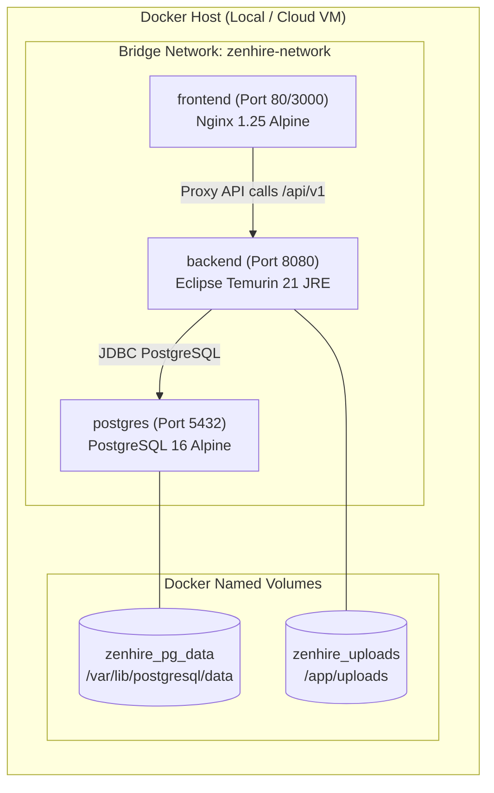

# ZenHire — High-Level Design (HLD)

> **Document Type:** System Architecture & High-Level Design (HLD)  
> **Architecture Style:** Modular Monolith (Spring Boot 3 + React 18 + PostgreSQL 16)  
> **Version:** 1.0.0 (Production Blueprint)

---

## 1. Architectural Vision & Style Rationale

ZenHire is architected as an **Enterprise Modular Monolith**.

### Why Modular Monolith?
1. **Domain Cohesion without Distributed Overhead:** ZenHire’s core domain models—Candidates, Jobs, Resumes, Assessments, Applications, and Interviews—are tightly coupled by business transactions (e.g., verifying test attempts before creating an application within a single database transaction). Introducing microservices prematurely would incur high network latency, distributed transaction complexities (2PC / Sagas), distributed tracing overhead, and deployment friction.
2. **Strict In-Process Module Boundaries:** The backend is organized into high-cohesion, loosely coupled packages by feature (`com.zenhire.candidate`, `com.zenhire.job`, `com.zenhire.assessment`, `com.zenhire.application`, `com.zenhire.matching`, `com.zenhire.ai`). Inter-module communication occurs via well-defined Java service interfaces rather than raw entity coupling.
3. **Future Microservices Readability:** Because boundaries are clean and dependencies are inverted, extracting individual modules (such as the `AI Matching Engine` or `Assessment Service`) into independent microservices in the future requires minimal refactoring.

---

## 2. System Topology & Component Interactions

```mermaid
flowchart TB
    subgraph ClientTier["Client Tier (Presentation Layer)"]
        Browser["User Web Browser (Desktop / Mobile)"]
        ReactApp["React 18 SPA (Vite + TypeScript)"]
        Browser -->|Interacts with| ReactApp
    end

    subgraph IngressTier["Network Ingress & Reverse Proxy"]
        NginxProxy["Nginx Web Server / Gateway (Port 80/443)"]
        ReactApp -->|Static Assets| NginxProxy
        ReactApp -->|REST API Calls (JSON)| NginxProxy
    end

    subgraph BackendTier["Application Tier (Spring Boot 3.3.x Modular Monolith)"]
        SecurityGateway["Spring Security 6 (JWT Auth Filter & RBAC Guard)"]
        
        subgraph CoreModules["Business Logic Modules"]
            AuthModule["Auth & Identity Module"]
            CandidateModule["Candidate Profile Module"]
            JobModule["Job Requisitions Module"]
            ResumeModule["Resume Processing Module"]
            AssessmentModule["Assessment & Gating Module"]
            ApplicationModule["Application Workflow Module"]
            MatchingModule["Hybrid AI Matching Engine"]
            AiAdvisorModule["AI Career Advisor Module"]
        end
        
        SecurityGateway --> CoreModules
    end

    subgraph IntegrationTier["Integration & Extraction Layer"]
        PDFBoxLib["Apache PDFBox 3.x (Document Text Extractor)"]
        GeminiClient["Google Gemini 1.5 REST Client (Spring WebClient)"]
    end

    subgraph DataTier["Data Persistence Tier"]
        PostgresDB[(PostgreSQL 16 Database)]
        FlywayEngine["Flyway Migration Engine (Schema Versioning)"]
        FileStorage[(Persistent Volume: /app/uploads)]
    end

    NginxProxy -->|HTTP Forwarding :8080| SecurityGateway
    ResumeModule -->|Extracts stream| PDFBoxLib
    ResumeModule -->|Stores PDF file| FileStorage
    MatchingModule -->|Qualitative prompt| GeminiClient
    AiAdvisorModule -->|Contextual prompt| GeminiClient
    ResumeModule -->|Structured JSON prompt| GeminiClient

    CoreModules -->|Spring Data JPA / Hibernate| PostgresDB
    FlywayEngine -->|App Startup Migrations| PostgresDB
```

---

## 3. End-to-End Request Lifecycle & Data Flow

Below is the end-to-end execution path for a standard authenticated request (e.g., submitting a job application):

```mermaid
sequenceDiagram
    autonumber
    actor Candidate as Candidate Browser
    participant React as React SPA (Axios)
    participant Nginx as Reverse Proxy / Gateway
    participant JwtFilter as JwtAuthenticationFilter
    participant Controller as ApplicationController
    participant Validator as Bean Validation (@Valid)
    participant Service as ApplicationWorkflowService
    participant Matcher as HybridMatchingEngine
    participant AI as GeminiClient
    participant Repo as ApplicationRepository
    participant DB as PostgreSQL 16

    Candidate->>React: Click "Apply to Job"
    React->>Nginx: POST /api/v1/jobs/{jobId}/apply (Bearer Token)
    Nginx->>JwtFilter: Forward Request
    JwtFilter->>JwtFilter: Validate HMAC-SHA256 signature & parse claims
    JwtFilter->>JwtFilter: Set SecurityContextHolder with UserPrincipal
    JwtFilter->>Controller: Dispatch to applyToJob(jobId, principal)
    Controller->>Validator: Validate path variables & payload constraints
    Controller->>Service: applyToJob(candidateId, jobId)
    
    rect rgb(20, 30, 45)
        note over Service,DB: Transaction Boundary (@Transactional)
        Service->>DB: Check existing application (Unique candidateId + jobId)
        Service->>DB: Verify candidate has passed category assessment
        alt Not Passed
            Service-->>Controller: Throw AssessmentGatingException
            Controller-->>React: 403 Forbidden { requiredTestId, roleCategory }
        end
        Service->>Matcher: computeMatchScore(candidateSkills, jobSkills, narrativeFit)
        Matcher->>Matcher: Calculate deterministic skill overlap (60%)
        Matcher->>AI: Evaluate narrative fit (40%)
        AI-->>Matcher: llmFitScore & reasoning
        Matcher-->>Service: finalScore, matchedSkills, missingSkills
        Service->>Repo: save(Application entity)
        Repo->>DB: INSERT INTO applications (...)
        DB-->>Repo: Saved entity with generated UUID
    end

    Service-->>Controller: ApplicationResponseDto
    Controller-->>React: 201 Created { application: ApplicationResponseDto }
    React-->>Candidate: Display success banner and update application tracker
```



---

## 4. Subsystem Breakdown

### 4.1 Frontend Client (React 18 + TypeScript)
- **Role:** Single Page Application (SPA) providing an interactive, responsive user interface.
- **Key Subsystems:**
  - `AuthContext`: Centralized authentication state, token storage, and session refresh.
  - `ProtectedRoute`: Role-based route guards blocking unauthorized URL navigation.
  - `ApiService`: Axios instances configured with request/response interceptors for automatic JWT injection and unified error normalization.
  - `UI Component Library`: shadcn/ui primitives styled with Tailwind CSS, ensuring accessibility and consistent aesthetics.

### 4.2 Security & Ingress Layer
- **Role:** Enforces edge security, CORS policies, rate limiting, and request authentication.
- **Key Components:**
  - `SecurityConfig`: Spring Security 6 filter chain configuring stateless session management (`SessionCreationPolicy.STATELESS`).
  - `JwtAuthenticationFilter`: Extracts JWT from `Authorization: Bearer <token>`, validates cryptographic signature, checks expiration, and establishes the Spring Security `Authentication` token.
  - `DelegatedAuthenticationEntryPoint`: Handles authentication failures with clean JSON error responses (`401 Unauthorized`).
  - `CustomAccessDeniedHandler`: Handles role authorization failures (`403 Forbidden`).

### 4.3 Backend Service Layer (Modular Monolith)
- **Role:** Implements core business logic, transaction management, assessment evaluation, and orchestration.
- **Key Subsystems:**
  - `ResumeParserService`: Orchestrates Apache PDFBox text extraction and calls Gemini LLM to parse technical skills, experience, and education.
  - `HybridMatchingEngine`: Combines normalized deterministic string overlap with LLM narrative evaluation using the 60/40 weighted formula.
  - `AssessmentService`: Delivers masked questions, validates answers, computes score percentages, and records attempts.
  - `ApplicationWorkflowService`: Manages application state machine transitions and interview scheduling.
  - `AiAdvisorService`: Compiles candidate context and manages conversation history for the AI chatbot.

### 4.4 Data Layer (PostgreSQL 16 + Flyway)
- **Role:** ACID-compliant relational storage ensuring data integrity and durability.
- **Key Components:**
  - **Relational Schema:** Normalized tables with explicit primary keys (`UUID`), foreign keys, uniqueness constraints, and check constraints.
  - **Flyway Migrations:** Incremental, version-controlled SQL scripts (`V1__initial_schema.sql`, `V2__seed_questions.sql`) guaranteeing deterministic environment setup.
  - **Indexing:** B-Tree indexes on foreign keys, email lookups, and status filters.

---

## 5. Deployment & Container Architecture

The platform is fully containerized using multi-stage Docker builds and orchestrated with Docker Compose:



### Container Startup & Healthcheck Sequence:
1. **PostgreSQL Container:** Starts first; executes internal health check (`pg_isready -U zenhire_user -d zenhire_db`).
2. **Backend Spring Boot Container:** Starts only after PostgreSQL container reports healthy (`condition: service_healthy`); executes Flyway migrations; starts Spring HTTP server on port 8080.
3. **Frontend React Container:** Starts; serves compiled static assets and proxies `/api` calls to the backend service.

