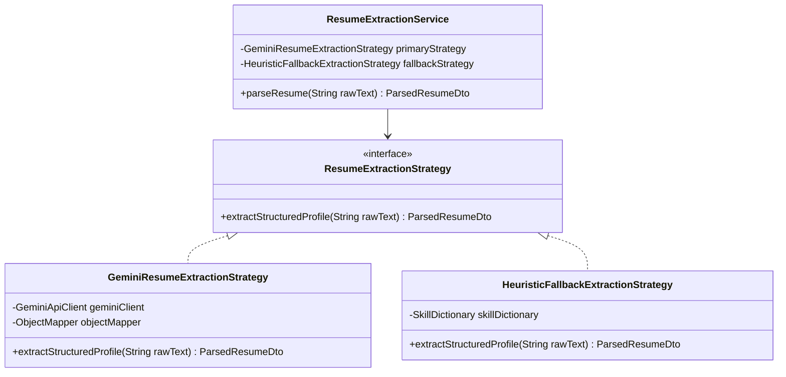
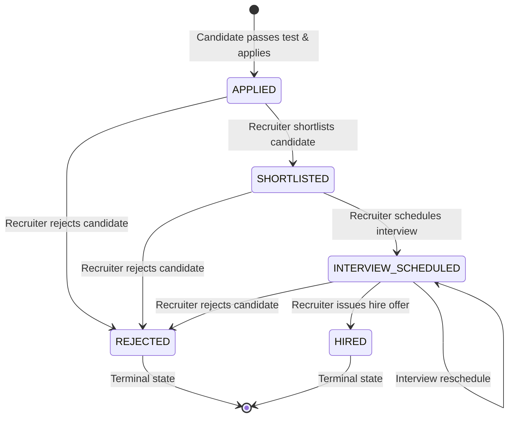
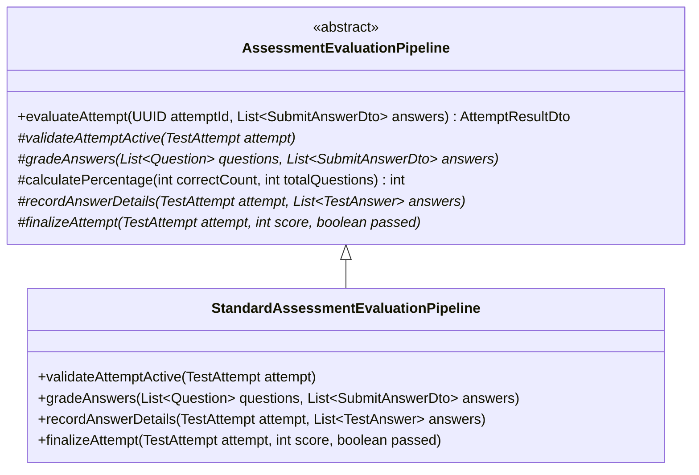
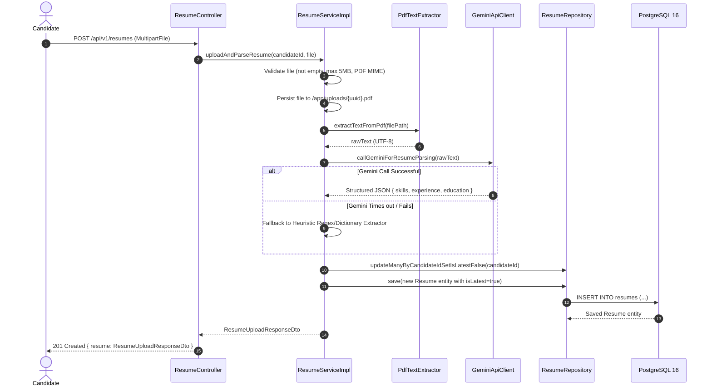
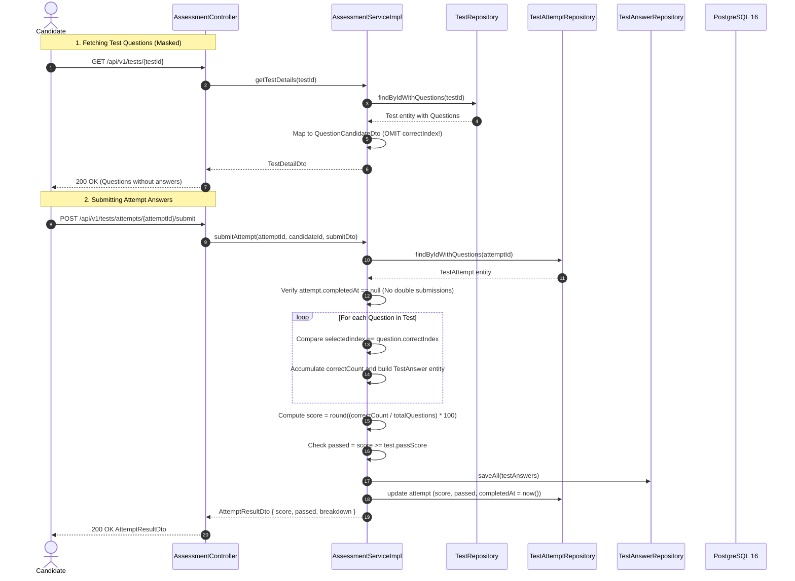
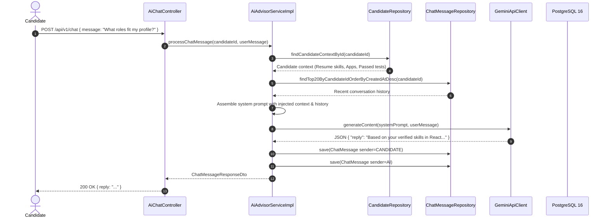

# ZenHire — Low-Level Design (LLD)

> **Document Type:** Software Detailed Design & Low-Level Design (LLD)  
> **Target Framework:** Java 21 / Spring Boot 3.3.x / Spring Data JPA  
> **Version:** 1.0.0 (Production Blueprint)

---

## 1. Backend Package Organization

ZenHire utilizes a **Package-by-Feature** modular design to ensure high cohesion and maintain strict boundaries:

```
com.zenhire
├── ZenHireApplication.java
├── common
│   ├── dto
│   │   ├── ApiResponse.java           # Standardized API envelope
│   │   └── PageResponse.java          # Standardized pagination wrapper
│   ├── exception
│   │   ├── BaseApiException.java      # Root runtime exception
│   │   ├── ResourceNotFoundException.java
│   │   ├── DuplicateResourceException.java
│   │   ├── UnauthorizedException.java
│   │   ├── ForbiddenOperationException.java
│   │   ├── InvalidWorkflowStateException.java
│   │   ├── AssessmentGatingException.java
│   │   └── GlobalExceptionHandler.java # @RestControllerAdvice
│   └── util
│       ├── SecurityUtils.java         # Current authenticated user extractor
│       └── DateTimeUtils.java
├── config
│   ├── SecurityConfig.java            # Spring Security 6 filter chain
│   ├── CorsConfig.java                # WebMvc CORS policy
│   ├── WebClientConfig.java           # Reactive WebClient bean for Gemini API
│   └── OpenApiConfig.java             # Swagger 3 / OpenAPI docs
├── security
│   ├── JwtTokenProvider.java          # Token generator & claims validator
│   ├── JwtAuthenticationFilter.java   # OncePerRequestFilter for Bearer tokens
│   ├── UserPrincipal.java             # UserDetails implementation
│   ├── CustomUserDetailsService.java  # UserDetailsService implementation
│   ├── DelegatedAuthEntryPoint.java   # 401 Unauthorized handler
│   └── CustomAccessDeniedHandler.java # 403 Forbidden handler
├── auth
│   ├── controller
│   │   └── AuthController.java
│   ├── dto
│   │   ├── RegisterRequestDto.java
│   │   ├── LoginRequestDto.java
│   │   └── AuthResponseDto.java
│   ├── service
│   │   ├── AuthService.java           # Interface
│   │   └── impl
│   │       └── AuthServiceImpl.java
│   └── mapper
│       └── UserMapper.java
├── user
│   ├── entity
│   │   ├── User.java                  # Base user entity
│   │   ├── Role.java                  # Enum: ROLE_CANDIDATE, ROLE_RECRUITER
│   │   ├── Candidate.java             # 1-to-1 extension
│   │   └── Recruiter.java             # 1-to-1 extension
│   └── repository
│       ├── UserRepository.java
│       ├── CandidateRepository.java
│       └── RecruiterRepository.java
├── candidate
│   ├── controller
│   │   └── CandidateController.java
│   ├── dto
│   │   ├── CandidateDashboardDto.java
│   │   ├── CandidateAnalysisDto.java
│   │   └── CandidateProfileUpdateDto.java
│   └── service
│       ├── CandidateService.java
│       └── impl
│           └── CandidateServiceImpl.java
├── job
│   ├── entity
│   │   ├── Job.java
│   │   ├── RoleCategory.java          # Enum: FRONTEND, BACKEND, AI_ML
│   │   └── JobStatus.java             # Enum: OPEN, CLOSED
│   ├── dto
│   │   ├── CreateJobRequestDto.java
│   │   ├── JobResponseDto.java
│   │   └── JobDetailResponseDto.java
│   ├── repository
│   │   └── JobRepository.java
│   ├── service
│   │   ├── JobService.java
│   │   └── impl
│   │       └── JobServiceImpl.java
│   └── mapper
│       └── JobMapper.java
├── resume
│   ├── entity
│   │   └── Resume.java
│   ├── dto
│   │   ├── ResumeUploadResponseDto.java
│   │   └── ParsedResumeDto.java
│   ├── repository
│   │   └── ResumeRepository.java
│   ├── service
│   │   ├── ResumeService.java
│   │   └── impl
│   │       └── ResumeServiceImpl.java
│   └── extractor
│       ├── PdfTextExtractor.java      # Apache PDFBox wrapper
│       └── ResumeExtractionStrategy.java
├── assessment
│   ├── entity
│   │   ├── Test.java
│   │   ├── TestType.java              # Enum: GENERAL, ROLE_SPECIFIC
│   │   ├── Question.java
│   │   ├── Difficulty.java            # Enum: EASY, MEDIUM, HARD
│   │   ├── TestAttempt.java
│   │   └── TestAnswer.java
│   ├── dto
│   │   ├── TestDetailDto.java
│   │   ├── QuestionCandidateDto.java  # MASKED: no correctIndex!
│   │   ├── StartAttemptResponseDto.java
│   │   ├── SubmitAttemptRequestDto.java
│   │   └── AttemptResultDto.java
│   ├── repository
│   │   ├── TestRepository.java
│   │   ├── QuestionRepository.java
│   │   ├── TestAttemptRepository.java
│   │   └── TestAnswerRepository.java
│   └── service
│       ├── AssessmentService.java
│       └── impl
│           └── AssessmentServiceImpl.java
├── application
│   ├── entity
│   │   ├── Application.java
│   │   ├── ApplicationStatus.java     # APPLIED, SHORTLISTED, INTERVIEW_SCHEDULED, REJECTED, HIRED
│   │   ├── Interview.java
│   │   ├── InterviewMode.java         # ONLINE, OFFLINE
│   │   └── InterviewStatus.java       # SCHEDULED, COMPLETED, CANCELLED
│   ├── dto
│   │   ├── ApplicationResponseDto.java
│   │   ├── CandidateApplicationSummaryDto.java
│   │   ├── ApplicantRankingDto.java
│   │   ├── ScheduleInterviewRequestDto.java
│   │   └── InterviewResponseDto.java
│   ├── repository
│   │   ├── ApplicationRepository.java
│   │   └── InterviewRepository.java
│   └── service
│       ├── ApplicationWorkflowService.java
│       └── impl
│           └── ApplicationWorkflowServiceImpl.java
├── matching
│   ├── dto
│   │   └── MatchScoreResultDto.java
│   ├── service
│   │   ├── HybridMatchingEngine.java  # Interface
│   │   └── impl
│   │       └── HybridMatchingEngineImpl.java
│   └── algorithm
│       └── DeterministicSkillMatcher.java
└── ai
    ├── client
    │   └── GeminiApiClient.java       # WebClient driver for Gemini REST API
    ├── prompt
    │   ├── PromptTemplates.java       # Centralized system and user prompts
    │   └── PromptSanitizer.java       # Sanitizes untrusted user text
    ├── dto
    │   ├── GeminiRequestDto.java
    │   ├── GeminiResponseDto.java
    │   ├── LlmFitEvaluationDto.java
    │   └── LlmChatReplyDto.java
    └── service
        ├── AiAdvisorService.java
        └── impl
            └── AiAdvisorServiceImpl.java
```

---

## 2. Key Design Patterns & Implementation Mechanics

### 2.1 Strategy Pattern: Resume Extraction Fallback Strategy

- **Rationale:** If the primary Gemini LLM call times out or exceeds rate limits, the system dynamically delegates extraction to the `HeuristicFallbackExtractionStrategy` without disrupting user workflow.

### 2.2 State Machine Pattern: Application Lifecycle State Transitions
The application status follows a strict finite state machine enforced in `ApplicationWorkflowServiceImpl`:


- **Transition Guard Rules:**
  - Transitioning to `SHORTLISTED` requires current status to be `APPLIED`.
  - Transitioning to `INTERVIEW_SCHEDULED` requires current status to be `SHORTLISTED` or `INTERVIEW_SCHEDULED`.
  - Transitioning to `HIRED` requires current status to be `INTERVIEW_SCHEDULED`.
  - Rejection is valid from any non-terminal state (`APPLIED`, `SHORTLISTED`, `INTERVIEW_SCHEDULED`).
  - Terminal states (`HIRED`, `REJECTED`) reject any further transitions with `InvalidWorkflowStateException`.

### 2.3 Template Method Pattern: Assessment Submission & Scoring Pipeline


---

## 3. Sequence Diagrams for Critical Workflows

### 3.1 Resume Upload, PDF Extraction & AI Parsing Sequence


### 3.2 Assessment Attempt Grading & Answer Masking Sequence


### 3.3 Context-Grounded AI Career Advisor Conversation


---

## 4. Exception Handling Strategy

ZenHire uses a centralized `@RestControllerAdvice` class (`GlobalExceptionHandler`) to translate all business, security, and validation exceptions into standardized `ApiResponse<T>` error structures:

```java
public record ApiResponse<T>(
    boolean success,
    String message,
    T data,
    ApiError error,
    Instant timestamp
) {}

public record ApiError(
    String errorCode,
    String details,
    List<ValidationErrorItem> validationErrors
) {}
```

### Mapped Exception HTTP Status Matrix:
| Exception Class | HTTP Status | Error Code | Description |
| :--- | :--- | :--- | :--- |
| `MethodArgumentNotValidException` | `400 Bad Request` | `VALIDATION_FAILED` | JSR-380 bean validation violations |
| `ResourceNotFoundException` | `404 Not Found` | `RESOURCE_NOT_FOUND` | Missing entity by ID / query |
| `DuplicateResourceException` | `400 Bad Request` | `DUPLICATE_RESOURCE` | Duplicate email or duplicate job application |
| `InvalidWorkflowStateException` | `400 Bad Request` | `INVALID_STATUS_TRANSITION` | Illegal state machine transition |
| `AssessmentGatingException` | `403 Forbidden` | `ASSESSMENT_GATE_REQUIRED` | Application blocked pending test pass |
| `BadCredentialsException` | `401 Unauthorized` | `INVALID_CREDENTIALS` | Incorrect username or password |
| `AccessDeniedException` | `403 Forbidden` | `ACCESS_DENIED` | Insufficient role permissions / cross-tenant leak |
| `MaxUploadSizeExceededException` | `400 Bad Request` | `FILE_TOO_LARGE` | Upload exceeds 5 MB limit |
| `Exception` (catch-all) | `500 Internal Error` | `INTERNAL_SERVER_ERROR` | Unhandled unexpected server exception |
