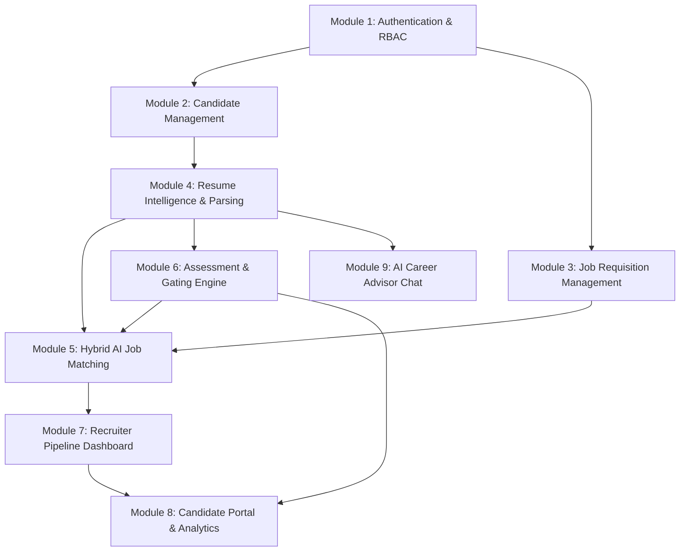
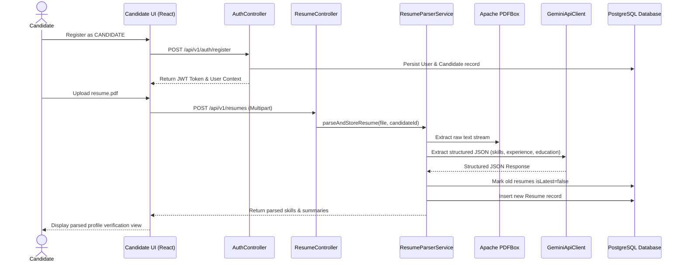
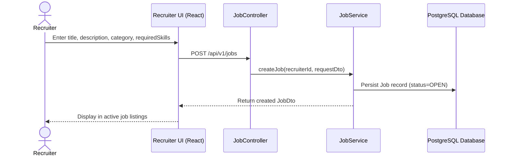
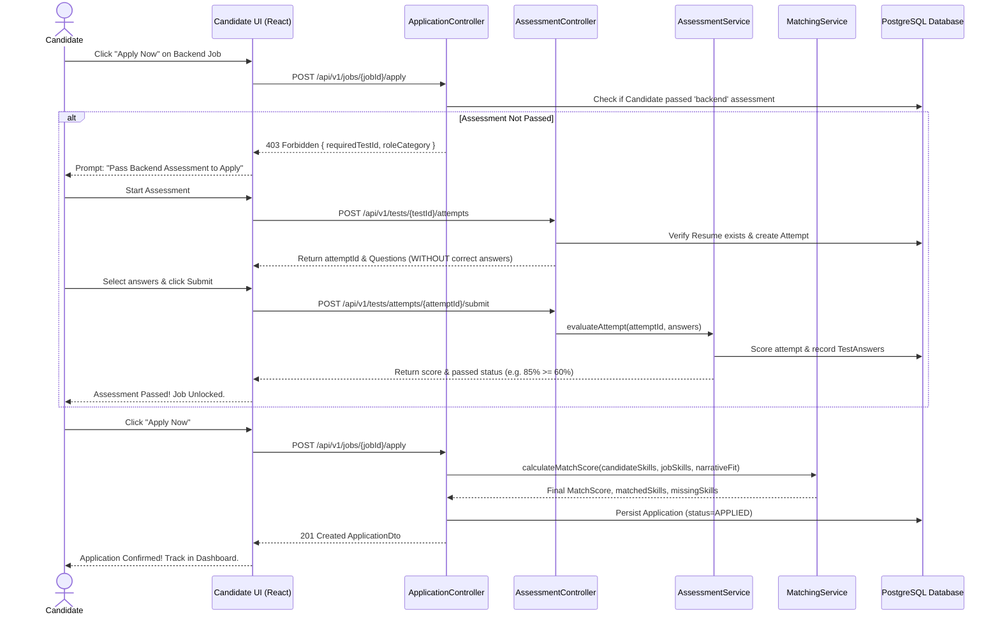
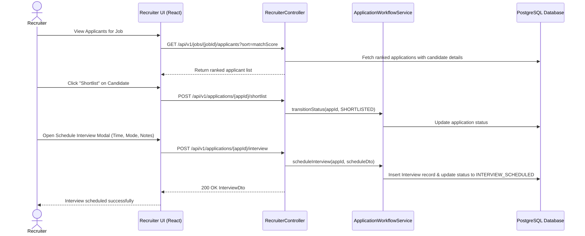

# ZenHire — Project Overview & Product Vision

> **Tagline:** Smarter Hiring. Better Matches.  
> **Document Type:** Project Charter & Product Overview  
> **Version:** 1.0.0 (Production Blueprint)

---

## 1. Executive Problem Statement

Modern technical recruitment is fundamentally broken on both sides of the hiring equation:

1. **The Resume Keyword Stacking Dilemma:** Candidates frequently optimize resumes for primitive Applicant Tracking Systems (ATS) through keyword stuffing, leading to resume inflation and masking true engineering proficiency.
2. **Recruiter Fatigue & Inefficient Sifting:** Technical recruiters receive hundreds of unvetted applications per job posting. Sifting through unstructured PDFs manually leads to superficial evaluation, cognitive exhaustion, and missed top-tier talent.
3. **The "Black Hole" Candidate Experience:** Candidates submit applications into opaque portals with zero constructive feedback, no visibility into why they were rejected, and no clear pathway to demonstrate verified technical capability.
4. **Subjective & Inconsistent Matching:** Keyword-based ATS matching fails to capture contextual nuance, technical depth, or semantic project experience. Conversely, purely generative AI models hallucinate arbitrary match scores without deterministic grounding.

**ZenHire** resolves this structural failure by introducing an **objective, skills-first recruitment and talent intelligence platform** that combines:
- Industrial-grade resume extraction (Apache PDFBox + Google Gemini 1.5).
- Mandatory assessment gating to verify baseline competencies prior to application submission.
- A transparent, hybrid matching algorithm that combines deterministic skill overlap with contextual LLM narrative evaluation.
- An interactive, context-aware AI Career Advisor that grounds guidance in the candidate's verified profile data.

---

## 2. Product Objectives

ZenHire is engineered to fulfill five primary product objectives:

| Objective ID | Objective Title | Description & Success Metric |
| :--- | :--- | :--- |
| **OBJ-01** | **Automated Profile Intelligence** | Eliminate manual data entry by extracting technical skills, professional experience summaries, and education history from PDF resumes with ≥95% parsing accuracy. |
| **OBJ-02** | **Technical Competency Verification** | Filter out unqualified submissions by enforcing category-specific multiple-choice assessments (`FRONTEND`, `BACKEND`, `AI_ML`) before application submission is permitted. |
| **OBJ-03** | **Fair & Explainable Matching** | Provide recruiters with an explainable candidate ranking score (0–100) calculated using a hybrid formula (60% deterministic skill overlap + 40% LLM narrative evaluation) with clear matched and missing skill lists. |
| **OBJ-04** | **Streamlined Pipeline Velocity** | Accelerate recruiter review-to-interview cycle time through an intuitive pipeline status workflow (`APPLIED` ➔ `SHORTLISTED` ➔ `INTERVIEW_SCHEDULED` ➔ `HIRED`) and integrated interview scheduling. |
| **OBJ-05** | **Actionable Candidate Empowerment** | Deliver actionable feedback to candidates via an automated Strengths & Weaknesses analysis dashboard and a private, context-grounded AI Career Advisor. |

---

## 3. Target User Personas

### Persona 1: Alex Rivera — Technical Candidate
- **Background:** Software Engineer with 2.5 years of experience specializing in Java, Spring Boot, and React.
- **Pain Points:** 
  - Submits dozens of resumes weekly to generic job boards and receives automated rejections without explanation.
  - Feels resumes are discarded by keyword scrapers before human recruiters ever review GitHub projects or actual skills.
- **Goals in ZenHire:**
  - Upload his resume, view what skills the system extracts, and verify profile accuracy.
  - Complete backend assessments to prove technical competence and unlock high-quality backend engineering positions.
  - Track real-time progress of his applications and consult the AI Career Advisor to identify skill gaps.

### Persona 2: Sarah Chen — Technical Talent Lead / Recruiter
- **Background:** Senior Talent Acquisition Manager at a high-growth tech enterprise, responsible for hiring across engineering departments.
- **Pain Points:**
  - Inundated with 300+ applicant PDFs per open role; over 70% lack core prerequisites.
  - Struggles to quickly compare candidate qualifications against complex engineering job descriptions.
  - Spends hours coordinating initial screenings with candidates whose technical competence has not been validated.
- **Goals in ZenHire:**
  - Create targeted job requisitions specifying mandatory skills and role categories.
  - Review candidate pipelines pre-ranked by objective match scores, knowing every applicant has already passed a rigorous domain assessment.
  - Inspect candidate matched vs. missing skills, review parsed resumes, shortlist candidates, schedule interviews, and issue offers.

### Persona 3: Marcus Vance — Platform Administrator / Engineering Mentor
- **Background:** Director of Engineering overseeing talent operations and assessment integrity.
- **Goals in ZenHire:**
  - Maintain the assessment question repository with balanced difficulty distributions and accurate topic tags.
  - Audit system security, role-based access control, and prompt engineering parameters.
  - Ensure zero data leakage between competing hiring organizations and secure management of candidate personal data.

---

## 4. Functional Scope & Modules

ZenHire comprises nine cohesive, loosely coupled functional modules:

### Module Breakdown:
1. **Module 1: Authentication and Authorization:** Secure JWT token lifecycle (access + refresh), BCrypt password hashing, role-based authorization (`ROLE_CANDIDATE`, `ROLE_RECRUITER`), and stateless request filtering.
2. **Module 2: Candidate Management:** Candidate biographical data, professional headline, phone contact, resume revision history, application records, and profile completion tracking.
3. **Module 3: Job Management:** Job posting lifecycle (`OPEN`, `CLOSED`), role classification (`FRONTEND`, `BACKEND`, `AI_ML`), technical skill specifications, and search/category filtering.
4. **Module 4: Resume Intelligence:** Multipart PDF upload, Apache PDFBox text extraction, Gemini LLM structured information extraction (skills, experience summary, education history), and validation.
5. **Module 5: AI-Powered Job Matching:** 60/40 hybrid matching algorithm combining deterministic skill overlap with LLM narrative evaluation, computing matched skills, missing skills, and ranking.
6. **Module 6: Assessments & Gating:** Assessment question catalog, time-stamped attempts, single-submission enforcement, correct answer masking, automated percentage scoring, and application prerequisite gating.
7. **Module 7: Recruiter Dashboard:** Aggregated KPI metrics (open roles, applicants, shortlists), ranked candidate lists, dossier inspection, candidate shortlisting/rejection/hiring, and interview scheduling.
8. **Module 8: Candidate Dashboard:** Overview of resume synchronization status, active applications tracking, category assessment cards, strengths/weaknesses topic analytics, and job recommendations.
9. **Module 9: AI Recruitment Assistant:** Context-grounded conversational agent utilizing candidate resume details, test accomplishments, and application statuses to answer candidate queries without hallucination.

---

## 5. Non-Functional Requirements (NFRs)

| Dimension | Requirement Specification | Architecture Strategy |
| :--- | :--- | :--- |
| **Performance & Latency** | - API response time: ≤ 150 ms for cached/simple queries. - Resume parsing: ≤ 3.5 seconds including LLM extraction. - Matching score computation: ≤ 1.5 seconds per candidate-job pair. | Database indexing on foreign keys and lookup columns; asynchronous background file processing where appropriate; connection pooling via HikariCP. |
| **Security & Privacy** | - Passwords hashed using BCrypt (cost factor 12). - Stateless JWT with HMAC-SHA256 signature verification. - Role-based access control enforced at both API and service layers. - Sanitized file uploads (magic bytes, MIME type validation, 5MB limit). | Spring Security 6 filter chain, `@PreAuthorize` method annotations, strict DTO projection (preventing answer/credential leaks). |
| **Data Integrity & Consistency** | - ACID compliance for all business transactions. - Zero orphan records. - Idempotent schema migrations. | PostgreSQL relational constraints, foreign keys with `ON DELETE CASCADE / SET NULL`, Flyway version-controlled migrations. |
| **Reliability & Resilience** | - 99.9% application uptime. - Graceful degradation upon AI provider rate limits or network outages. | Fallback mock parsing heuristics; exponential backoff retries; circuit breaker patterns for external Gemini API calls. |
| **Scalability & Modularity** | - Clean layered modular monolith architecture capable of seamless extraction into microservices if volume demands. | Strict package-by-feature encapsulation; dependency inversion; service interfaces decoupling business logic from external drivers. |
| **Portability & Deployment** | - One-command reproducible local and staging deployment via Docker Compose. | Multi-stage Dockerfiles for Spring Boot (Eclipse Temurin 21) and React (Nginx Alpine); persistent Docker named volumes for PostgreSQL and uploads. |

---

## 6. Core Application Workflows

### Workflow 1: Candidate Onboarding & Resume Intelligence

### Workflow 2: Recruiter Job Posting & Requisition Lifecycle

### Workflow 3: Assessment Gating & Application Submission

### Workflow 4: Recruiter Review, Shortlisting & Interview Scheduling

