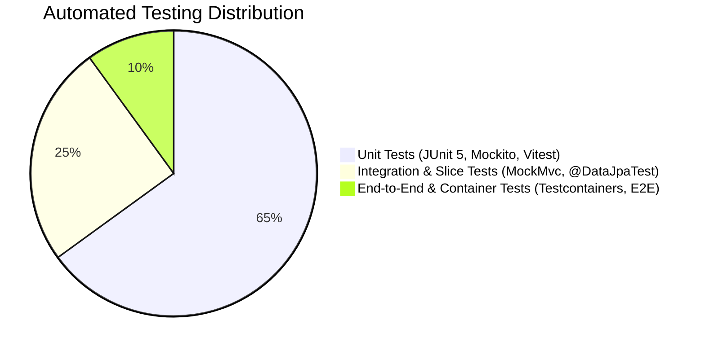

# ZenHire — Comprehensive Testing Strategy

> **Document Type:** Quality Assurance & Automated Testing Strategy  
> **Testing Frameworks:** JUnit 5 / Mockito / MockMvc / AssertJ / Testcontainers / Vitest / React Testing Library  
> **Version:** 1.0.0 (Production Blueprint)

---

## 1. Testing Pyramid & Principles

ZenHire adheres to the industry-standard **Testing Pyramid** to maximize test coverage while minimizing test execution latency:



### Core Testing Principles:
1. **Deterministic & Isolated:** Tests must never depend on external network availability. Calls to Google Gemini are mocked via Mockito or recorded wiremocks.
2. **Fast Feedback Loops:** Unit tests execute in under 30 seconds across the entire test suite.
3. **High Business Logic Coverage:** Critical business algorithms (Hybrid Matching, Assessment Scoring, Application State Machine) target 100% branch coverage.
4. **Security by Verification:** Automated tests explicitly assert HTTP `401 Unauthorized` and `403 Forbidden` responses for unauthenticated and unauthorized role interactions.

---

## 2. Testing Layers & Tooling

| Layer | Target Under Test | Frameworks & Libraries | Verification Objective |
| :--- | :--- | :--- | :--- |
| **Unit Tests** | Domain Entities, Service Implementations, Utility functions, Mappers | JUnit 5, Mockito, AssertJ | Verify isolated algorithmic correctness, score calculations, edge cases, and state transitions without Spring context overhead. |
| **Slice Integration Tests** | REST Controllers, Security Filters, DTO Validations | `@WebMvcTest`, MockMvc, Spring Security Test | Verify URL mapping, JWT filter extraction, HTTP status codes, and JSR-380 bean validation without loading database beans. |
| **Data Layer Tests** | JPA Repositories, Custom Queries, Entity Mappings | `@DataJpaTest`, Testcontainers PostgreSQL | Verify SQL queries, relational constraints, foreign keys, and unique indices against an actual PostgreSQL engine. |
| **Frontend Component Tests** | React Pages, Form validation, Auth Context guards | Vitest, React Testing Library, User-Event | Verify UI rendering, button interactions, form error displays, and conditional navigation guards. |

---

## 3. Critical Edge Case Test Suite Specification

Below are the 13 mandatory production edge cases that must be verified by automated tests in ZenHire:

### Case 1: Duplicate User Email Registration
- **Scenario:** Candidate registers with an email that already exists in the `users` table.
- **Test Type:** MockMvc Integration Test (`AuthControllerTest`).
- **Expected Outcome:** HTTP `400 Bad Request` with error code `DUPLICATE_RESOURCE` and message `"User with this email already exists"`.

### Case 2: Recruiter Missing Mandatory Company Name
- **Scenario:** Registration payload with `role = "RECRUITER"` and empty or omitted `companyName`.
- **Test Type:** Unit / Controller Validation Test.
- **Expected Outcome:** HTTP `400 Bad Request` with validation error on field `companyName`.

### Case 3: Starting Assessment Without Uploaded Resume
- **Scenario:** Candidate attempts to invoke `POST /api/v1/tests/{testId}/attempts` without any resume recorded in `resumes` table.
- **Test Type:** Service Unit Test & MockMvc Test (`AssessmentServiceTest`).
- **Expected Outcome:** HTTP `400 Bad Request` with message `"You must upload at least one resume before starting an assessment."`

### Case 4: Answer Masking Security Verification
- **Scenario:** Candidate requests test details via `GET /api/v1/tests/{testId}`.
- **Test Type:** MockMvc Test (`AssessmentControllerTest`).
- **Expected Outcome:** HTTP `200 OK`. The JSON response must be inspected across all questions to assert that `correctIndex` is strictly `null` / omitted from JSON output.

### Case 5: Double Submission Gating on Test Attempts
- **Scenario:** Candidate submits an attempt that already has a non-null `completedAt` timestamp.
- **Test Type:** Service Unit Test (`AssessmentServiceTest`).
- **Expected Outcome:** HTTP `400 Bad Request` with message `"This test attempt has already been submitted."`

### Case 6: Recruiter Invalid Job Parameters (Bean Validation)
- **Scenario:** Recruiter creates a job with `description` under 10 characters, empty `requiredSkills`, or invalid `roleCategory`.
- **Test Type:** MockMvc Test (`JobControllerTest`).
- **Expected Outcome:** HTTP `400 Bad Request` with itemized field error diagnostics.

### Case 7: Cross-Recruiter Data Leak Gating
- **Scenario:** Recruiter B attempts to fetch applicants for a job owned by Recruiter A via `GET /api/v1/jobs/{jobId}/applicants`.
- **Test Type:** Security Integration Test (`RecruiterControllerSecurityTest`).
- **Expected Outcome:** HTTP `403 Forbidden` with message `"Unauthorized: You do not own this job posting."`

### Case 8: Role-Specific Assessment Application Gate
- **Scenario:** Candidate with an uploaded resume attempts to apply to a `BACKEND` job without passing the `BACKEND` role assessment.
- **Test Type:** Service & Integration Test (`JobApplicationWorkflowTest`).
- **Expected Outcome:** HTTP `403 Forbidden` with payload containing `requiredTest: { testId, roleCategory: "BACKEND" }`.

### Case 9: Duplicate Job Application Prevention
- **Scenario:** Candidate applies to a job they have already applied to.
- **Test Type:** Service & DB Constraint Test.
- **Expected Outcome:** HTTP `400 Bad Request` with message `"You have already applied to this job."` Database unique constraint `uq_candidate_job` is verified.

### Case 10: Invalid Application State Transitions (State Machine)
- **Scenario A:** Recruiter attempts to schedule an interview for a candidate in `APPLIED` status (must be `SHORTLISTED` first).
- **Scenario B:** Recruiter attempts to hire a candidate directly from `SHORTLISTED` (must be `INTERVIEW_SCHEDULED` first).
- **Scenario C:** Recruiter attempts to schedule an interview or hire an applicant in `REJECTED` or `HIRED` terminal state.
- **Test Type:** Unit Test (`ApplicationWorkflowServiceTest`).
- **Expected Outcome:** HTTP `400 Bad Request` with `InvalidWorkflowStateException`.

### Case 11: Hybrid Matching Engine Determinism
- **Scenario:** Candidate skills `["Java", "Spring Boot", "React"]` vs Job required skills `["Java", "Spring Boot", "PostgreSQL", "Docker"]`.
- **Calculation:** Matched = 2, Total = 4. `skillOverlapScore = (2/4) * 100 = 50%`. Mocked LLM fit score = 80%.
- **Expected Outcome:** `finalScore = round(0.6 * 50 + 0.4 * 80) = round(30 + 32) = 62%`. Matched skills = `["Java", "Spring Boot"]`, Missing skills = `["PostgreSQL", "Docker"]`.

### Case 12: AI Service Fallback Resilience
- **Scenario:** Google Gemini API returns HTTP 503 or times out during resume parsing.
- **Test Type:** Service Mock Test (`ResumeParserServiceTest`).
- **Expected Outcome:** Fallback heuristic parser executes, extracts standard technical skills from text, and returns a valid `ParsedResumeDto` without throwing an unhandled exception.

### Case 13: File Upload Validation & Security
- **Scenario A:** Uploading a 6 MB PDF file.
- **Scenario B:** Uploading an `.exe` file renamed to `.pdf`.
- **Test Type:** MockMvc File Upload Test (`ResumeControllerTest`).
- **Expected Outcome:** Scenario A returns `400 Bad Request` (`FILE_TOO_LARGE`). Scenario B returns `400 Bad Request` (`INVALID_FILE_CONTENT` due to magic byte verification failure).

---

## 4. Test Execution & Automation Commands

### Backend Automated Test Execution
```bash
# Run all unit and integration tests:
cd backend
mvn clean test

# Run a specific test class:
mvn test -Dtest=ApplicationWorkflowServiceTest

# Run tests with code coverage report (JaCoCo):
mvn test jacoco:report
# Open target/site/jacoco/index.html to view coverage
```

### Frontend Automated Test Execution
```bash
# Run Vitest test suite:
cd frontend
npm run test

# Run tests in watch mode:
npm run test:watch

# Run tests with coverage:
npm run test:coverage
```
